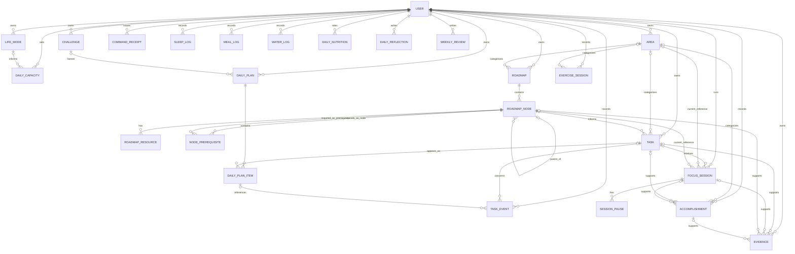
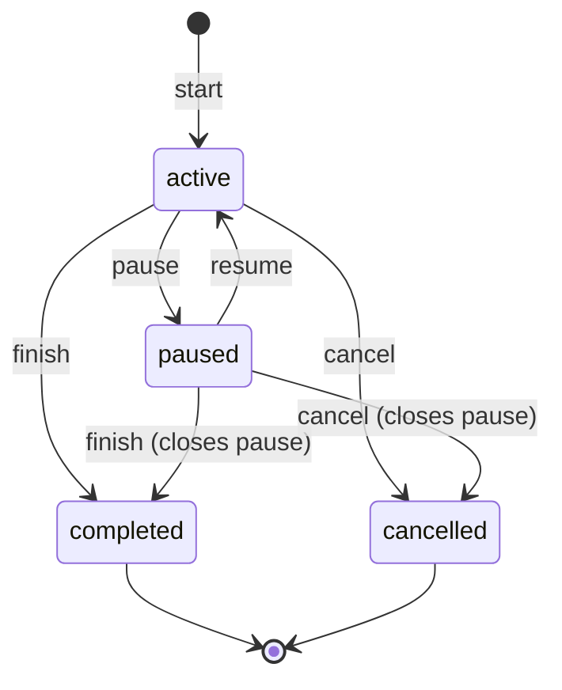

# CharityOS v0.1 — Architecture Review for ChatGPT

**Status:** Phase 0 proposal; not approved for implementation  
**Scope:** Architecture and schema review only  
**Explicit exclusions:** No application code, Django/React scaffolding, serializers, views, or migrations

This document consolidates the existing `ARCHITECTURE_REVIEW.md` for senior engineering review in ChatGPT. It preserves the complete proposed schema, relationships, constraints, roadmap and planning models, focus-session state machine, analytics and snapshots, authentication analysis, timezone rules, deletion and security reviews, alpha overengineering assessment, API inventory, and all unresolved product questions. If it conflicts with the approved product requirements, the PRD remains authoritative. This is a review artifact only: it does not approve Schema v1 or authorize Phase 1.

## 1. Proposed database schema

### 1.1 Database conventions

- PostgreSQL is the system of record.
- Application primary keys are `uuid`, generated with UUIDv4 by the application/database.
- Instants are `timestamptz` in UTC. Local calendar dates are `date`; local clock times, where needed, are `time` plus an IANA timezone snapshot.
- Mutable tables have `created_at timestamptz NOT NULL DEFAULT now()` and `updated_at timestamptz NOT NULL DEFAULT now()`. The application must update `updated_at`; a trigger is not proposed for v0.1.
- Human-facing status/type values use `varchar` plus `CHECK`, not PostgreSQL enum types, so future additions do not require enum surgery.
- User-owned records carry a direct `user_id` even when ownership is transitively inferable. This makes authorization queries explicit.
- Normal product deletion is archival/soft deletion where historical records depend on an entity. Hard deletion is reserved for mistakes with no dependants, retention cleanup, and full-account erasure.
- All indexes below are in addition to each table's primary-key index and indexes PostgreSQL creates for unique constraints. Foreign keys are indexed only when needed by actual query paths; PostgreSQL does not add them automatically.

Notation: `UQ` means unique constraint; `CK` means check constraint; `IDX` means index. Partial indexes show their predicate.

### 1.2 Identity and configuration

#### `users_user`

Custom Django user model, created in the first authorized migration.

| Field | PostgreSQL type | Null | Default | Notes |
|---|---|---:|---|---|
| `id` | `uuid` | no | UUIDv4 | PK |
| `email` | `varchar(254)` | no | — | Login identifier; normalized lowercase |
| `password` | `varchar(128)` | no | — | Django password hash, never plaintext |
| `display_name` | `varchar(100)` | no | `''` | User-facing name |
| `timezone` | `varchar(64)` | no | `'UTC'` | Valid IANA zone, application-validated |
| `week_starts_on` | `smallint` | no | `1` | ISO weekday, 1 Monday through 7 Sunday |
| `is_active` | `boolean` | no | `true` | Login enabled |
| `is_staff` | `boolean` | no | `false` | Django admin access |
| `is_superuser` | `boolean` | no | `false` | Django authorization flag |
| `last_login` | `timestamptz` | yes | `NULL` | Django auth metadata |
| `date_joined` | `timestamptz` | no | `now()` | Account creation |
| `created_at` | `timestamptz` | no | `now()` | Audit timestamp |
| `updated_at` | `timestamptz` | no | `now()` | Audit timestamp |

- UQ: `lower(email)` through a unique functional index.
- CK: `week_starts_on BETWEEN 1 AND 7`.
- IDX: `(is_active)` is unnecessary for alpha; Django admin can scan one row.
- Django's group/permission many-to-many tables may exist because of `PermissionsMixin`; they are framework-managed and are not product-domain entities.

#### `users_life_mode`

| Field | Type | Null | Default | Notes |
|---|---|---:|---|---|
| `id` | `uuid` | no | UUIDv4 | PK |
| `user_id` | `uuid` | no | — | FK → `users_user.id`, `ON DELETE CASCADE` |
| `name` | `varchar(80)` | no | — | e.g. Working |
| `default_available_minutes` | `integer` | no | `0` | Daily planning default |
| `default_deep_work_minutes` | `integer` | no | `0` | Daily planning default |
| `is_active` | `boolean` | no | `false` | Current preset |
| `archived_at` | `timestamptz` | yes | `NULL` | Soft deletion |
| `created_at`, `updated_at` | `timestamptz` | no | `now()` | Standard timestamps |

- UQ: `(user_id, lower(name)) WHERE archived_at IS NULL`.
- UQ: `(user_id) WHERE is_active AND archived_at IS NULL` (at most one active; the service ensures at least one where required).
- CK: both minute fields `BETWEEN 0 AND 1440`; an active mode cannot be archived.
- IDX: `(user_id, archived_at)`.

### 1.3 Challenges, areas, and capacity

#### `challenges_challenge`

| Field | Type | Null | Default | Notes |
|---|---|---:|---|---|
| `id` | `uuid` | no | UUIDv4 | PK |
| `user_id` | `uuid` | no | — | FK user, `ON DELETE CASCADE` |
| `name` | `varchar(120)` | no | — | Challenge name |
| `description` | `text` | no | `''` | Optional prose represented without null |
| `start_date` | `date` | no | — | Inclusive |
| `end_date` | `date` | no | — | Inclusive |
| `status` | `varchar(16)` | no | `'draft'` | `draft`, `active`, `completed`, `cancelled` |
| `is_primary` | `boolean` | no | `false` | Dashboard challenge |
| `archived_at` | `timestamptz` | yes | `NULL` | Soft deletion |
| `created_at`, `updated_at` | `timestamptz` | no | `now()` | Standard timestamps |

- UQ: `(user_id, lower(name)) WHERE archived_at IS NULL`.
- UQ: `(user_id) WHERE is_primary AND archived_at IS NULL`.
- CK: `end_date >= start_date`; valid status; primary challenge cannot be archived.
- IDX: `(user_id, status)`, `(user_id, start_date, end_date)`.

#### `planning_area`

| Field | Type | Null | Default | Notes |
|---|---|---:|---|---|
| `id` | `uuid` | no | UUIDv4 | PK |
| `user_id` | `uuid` | no | — | FK user, `ON DELETE CASCADE` |
| `name` | `varchar(80)` | no | — | User-defined |
| `slug` | `varchar(90)` | no | — | Stable per-user identifier |
| `color` | `varchar(7)` | no | `'#64748B'` | Hex RGB |
| `icon` | `varchar(50)` | no | `''` | Icon key, not markup |
| `sort_order` | `integer` | no | `0` | Display order |
| `archived_at` | `timestamptz` | yes | `NULL` | Soft deletion |
| `created_at`, `updated_at` | `timestamptz` | no | `now()` | Standard timestamps |

- UQ: `(user_id, lower(name)) WHERE archived_at IS NULL`; `(user_id, slug)`.
- CK: color matches `^#[0-9A-Fa-f]{6}$`; `sort_order >= 0`.
- IDX: `(user_id, archived_at, sort_order)`.

#### `planning_daily_capacity`

| Field | Type | Null | Default | Notes |
|---|---|---:|---|---|
| `id` | `uuid` | no | UUIDv4 | PK |
| `user_id` | `uuid` | no | — | FK user, `ON DELETE CASCADE` |
| `local_date` | `date` | no | — | Date in `timezone_name` |
| `timezone_name` | `varchar(64)` | no | — | IANA zone snapshot |
| `available_minutes` | `integer` | no | `0` | Available capacity |
| `deep_work_minutes` | `integer` | no | `0` | Deep-work capacity |
| `fixed_commitments` | `text` | no | `''` | V0.1 free text |
| `life_mode_id` | `uuid` | yes | `NULL` | FK life mode, `ON DELETE SET NULL` |
| `created_at`, `updated_at` | `timestamptz` | no | `now()` | Standard timestamps |

- UQ: `(user_id, local_date)`.
- CK: minutes `BETWEEN 0 AND 1440`; `deep_work_minutes <= available_minutes`.
- IDX: `(user_id, local_date DESC)`.

### 1.4 Roadmaps

#### `roadmaps_roadmap`

| Field | Type | Null | Default | Notes |
|---|---|---:|---|---|
| `id` | `uuid` | no | UUIDv4 | PK |
| `user_id` | `uuid` | no | — | FK user, `ON DELETE CASCADE` |
| `area_id` | `uuid` | yes | `NULL` | FK area, `ON DELETE SET NULL` |
| `title` | `varchar(160)` | no | — | Roadmap title |
| `description` | `text` | no | `''` | Description |
| `status` | `varchar(16)` | no | `'not_started'` | `not_started`, `in_progress`, `completed`, `skipped` |
| `position` | `integer` | no | `0` | User ordering |
| `completed_at` | `timestamptz` | yes | `NULL` | Explicit completion time |
| `archived_at` | `timestamptz` | yes | `NULL` | Soft deletion |
| `created_at`, `updated_at` | `timestamptz` | no | `now()` | Standard timestamps |

- UQ: `(user_id, lower(title)) WHERE archived_at IS NULL`.
- CK: valid status; `position >= 0`; completion timestamp present iff status is completed (or loosen this if reopening must retain history).
- IDX: `(user_id, archived_at, position)`, `(area_id)`.

#### `roadmaps_node`

| Field | Type | Null | Default | Notes |
|---|---|---:|---|---|
| `id` | `uuid` | no | UUIDv4 | PK |
| `user_id` | `uuid` | no | — | FK user, `ON DELETE CASCADE` |
| `roadmap_id` | `uuid` | no | — | FK roadmap, `ON DELETE CASCADE` only during hard account/roadmap erasure; normal roadmap deletion archives |
| `parent_id` | `uuid` | yes | `NULL` | Self FK, `ON DELETE RESTRICT` |
| `node_type` | `varchar(12)` | no | — | `track`, `module`, `topic`, `task` |
| `title` | `varchar(200)` | no | — | Node title |
| `description` | `text` | no | `''` | Details |
| `status` | `varchar(16)` | no | `'not_started'` | `not_started`, `in_progress`, `completed`, `skipped` |
| `priority` | `smallint` | no | `3` | 1 highest through 5 lowest |
| `position` | `integer` | no | `0` | Sibling order |
| `estimated_minutes` | `integer` | yes | `NULL` | Optional estimate |
| `notes` | `text` | no | `''` | User notes |
| `completed_at` | `timestamptz` | yes | `NULL` | Explicit completion time |
| `archived_at` | `timestamptz` | yes | `NULL` | Soft deletion; descendants handled transactionally |
| `created_at`, `updated_at` | `timestamptz` | no | `now()` | Standard timestamps |

- UQ: `(roadmap_id, parent_id, position) WHERE archived_at IS NULL`. Because `NULL`s are distinct, root ordering uses a second UQ `(roadmap_id, position) WHERE parent_id IS NULL AND archived_at IS NULL`.
- CK: valid type/status; priority `BETWEEN 1 AND 5`; `position >= 0`; estimate `> 0` when present; `parent_id <> id`; completion timestamp/status consistency.
- IDX: `(roadmap_id, parent_id, archived_at, position)`, `(user_id, status)`, GIN full-text expression over title/description/notes.
- Cross-row rules (same user/roadmap, valid parent type, no cycles) require transactional service validation; ordinary checks cannot inspect other rows.

#### `roadmaps_node_prerequisite`

| Field | Type | Null | Default | Notes |
|---|---|---:|---|---|
| `id` | `uuid` | no | UUIDv4 | PK |
| `node_id` | `uuid` | no | — | FK node, `ON DELETE CASCADE` |
| `prerequisite_id` | `uuid` | no | — | FK node, `ON DELETE RESTRICT` under normal operation; soft deletion preferred |
| `created_at` | `timestamptz` | no | `now()` | Creation timestamp |

- UQ: `(node_id, prerequisite_id)`.
- CK: `node_id <> prerequisite_id`.
- IDX: `(prerequisite_id)` for reverse dependency checks.
- Cross-row service rule: both nodes belong to the same user and roadmap; adding an edge must not create a prerequisite graph cycle.

#### `roadmaps_resource`

Multiple resources are allowed per node instead of a single URL column.

| Field | Type | Null | Default | Notes |
|---|---|---:|---|---|
| `id` | `uuid` | no | UUIDv4 | PK |
| `user_id` | `uuid` | no | — | FK user, `ON DELETE CASCADE` |
| `node_id` | `uuid` | no | — | FK node, `ON DELETE CASCADE` on hard erase |
| `label` | `varchar(160)` | no | `''` | Display label |
| `url` | `text` | no | — | `http`/`https` URL, application-validated |
| `resource_type` | `varchar(20)` | no | `'reference'` | `reference`, `course`, `video`, `documentation`, `exercise`, `other` |
| `position` | `integer` | no | `0` | Ordering |
| `created_at`, `updated_at` | `timestamptz` | no | `now()` | Standard timestamps |

- UQ: `(node_id, position)`; optional UQ `(node_id, url)` after URL canonicalization decision.
- CK: valid type; `position >= 0`; URL length is capped in application (for example 2048 characters).
- IDX: `(node_id, position)`.

### 1.5 Tasks and planning history

#### `tasks_task`

| Field | Type | Null | Default | Notes |
|---|---|---:|---|---|
| `id` | `uuid` | no | UUIDv4 | PK |
| `user_id` | `uuid` | no | — | FK user, `ON DELETE CASCADE` |
| `area_id` | `uuid` | yes | `NULL` | FK area, `ON DELETE SET NULL` |
| `roadmap_node_id` | `uuid` | yes | `NULL` | FK node, `ON DELETE SET NULL` |
| `title` | `varchar(240)` | no | — | Task title |
| `description` | `text` | no | `''` | Details |
| `status` | `varchar(16)` | no | `'planned'` | `planned`, `active`, `paused`, `completed`, `skipped` |
| `task_type` | `varchar(20)` | no | `'personal'` | `learning`, `building`, `exercise`, `reading`, `career`, `personal`, `recovery` |
| `priority` | `smallint` | no | `3` | 1–5 |
| `estimated_minutes` | `integer` | yes | `NULL` | Estimate |
| `is_deep_work` | `boolean` | no | `false` | Explicit analytics label |
| `completed_at` | `timestamptz` | yes | `NULL` | Completion instant |
| `skipped_at` | `timestamptz` | yes | `NULL` | Skip instant |
| `archived_at` | `timestamptz` | yes | `NULL` | Soft deletion |
| `created_at`, `updated_at` | `timestamptz` | no | `now()` | Standard timestamps |

- CK: valid status/type; priority `BETWEEN 1 AND 5`; estimate `> 0` when present; completed status requires `completed_at`; skipped status requires `skipped_at`; completed and skipped timestamps cannot both be set.
- IDX: `(user_id, status, archived_at)`, `(user_id, area_id, status)`, `(roadmap_node_id)`, GIN search index.
- No `planned_date`, `actual_minutes`, recurrence JSON, or `carried_over` status is proposed. Planning dates belong to plan items; actual minutes are derived; recurrence is unresolved.

#### `planning_daily_plan`

| Field | Type | Null | Default | Notes |
|---|---|---:|---|---|
| `id` | `uuid` | no | UUIDv4 | PK |
| `user_id` | `uuid` | no | — | FK user, `ON DELETE CASCADE` |
| `challenge_id` | `uuid` | yes | `NULL` | FK challenge, `ON DELETE SET NULL` |
| `local_date` | `date` | no | — | Planned local date |
| `timezone_name` | `varchar(64)` | no | — | Zone used for this day |
| `notes` | `text` | no | `''` | Day notes |
| `created_at`, `updated_at` | `timestamptz` | no | `now()` | Standard timestamps |

- UQ: `(user_id, local_date)`.
- IDX: `(user_id, local_date DESC)`, `(challenge_id, local_date)`.

#### `planning_daily_plan_item`

This is a dated appearance of a task and preserves what was planned that day.

| Field | Type | Null | Default | Notes |
|---|---|---:|---|---|
| `id` | `uuid` | no | UUIDv4 | PK |
| `user_id` | `uuid` | no | — | FK user, `ON DELETE CASCADE` |
| `daily_plan_id` | `uuid` | no | — | FK daily plan, `ON DELETE CASCADE` |
| `task_id` | `uuid` | yes | `NULL` | FK task, `ON DELETE SET NULL`; retained snapshot remains |
| `kind` | `varchar(12)` | no | `'secondary'` | `primary`, `secondary` |
| `position` | `smallint` | no | `0` | Order within kind |
| `title_snapshot` | `varchar(240)` | no | — | Title at planning time |
| `estimated_minutes_snapshot` | `integer` | yes | `NULL` | Estimate at planning time |
| `area_id_snapshot` | `uuid` | yes | `NULL` | Logical area ID snapshot, deliberately no FK |
| `area_name_snapshot` | `varchar(80)` | no | `''` | Historical display/grouping |
| `removed_at` | `timestamptz` | yes | `NULL` | Removal from plan without erasing history |
| `created_at`, `updated_at` | `timestamptz` | no | `now()` | Standard timestamps |

- UQ: `(daily_plan_id, task_id) WHERE task_id IS NOT NULL AND removed_at IS NULL`.
- UQ: `(daily_plan_id, kind, position) WHERE removed_at IS NULL`.
- CK: valid kind; `position >= 0`; estimate `> 0` when present.
- IDX: `(user_id, daily_plan_id, removed_at)` and `(task_id)`.
- Maximum three active primary items is enforced inside the same database transaction using a per-plan row lock. **Decision required:** add a PostgreSQL constraint trigger if stakeholders require the invariant to survive all out-of-band SQL writes. A normal `CHECK` cannot count sibling rows.

#### `planning_task_event`

Append-only planning/lifecycle audit relevant to carry-over.

| Field | Type | Null | Default | Notes |
|---|---|---:|---|---|
| `id` | `uuid` | no | UUIDv4 | PK |
| `user_id` | `uuid` | no | — | FK user, `ON DELETE CASCADE` |
| `task_id` | `uuid` | yes | `NULL` | FK task, `ON DELETE SET NULL` |
| `event_type` | `varchar(24)` | no | — | `planned`, `carried_over`, `removed`, `completed`, `skipped`, `reopened` |
| `from_local_date` | `date` | yes | `NULL` | Required for carry-over |
| `to_local_date` | `date` | yes | `NULL` | Required for plan/carry-over as appropriate |
| `daily_plan_item_id` | `uuid` | yes | `NULL` | FK plan item, `ON DELETE SET NULL` |
| `title_snapshot` | `varchar(240)` | no | — | Survives task erasure |
| `metadata` | `jsonb` | no | `'{}'::jsonb` | Small versioned context, not arbitrary domain storage |
| `occurred_at` | `timestamptz` | no | `now()` | Event time |
| `created_at` | `timestamptz` | no | `now()` | Persistence time |

- CK: valid event; carry-over requires non-null, different `from_local_date` and `to_local_date`; metadata is a JSON object.
- IDX: `(user_id, occurred_at DESC)`, `(task_id, occurred_at)`, `(to_local_date)`.

### 1.6 Focus execution and evidence

#### `sessions_focus_session`

| Field | Type | Null | Default | Notes |
|---|---|---:|---|---|
| `id` | `uuid` | no | UUIDv4 | PK |
| `user_id` | `uuid` | no | — | FK user, `ON DELETE CASCADE` for account erasure only |
| `task_id` | `uuid` | yes | `NULL` | FK task, `ON DELETE SET NULL` |
| `roadmap_node_id` | `uuid` | yes | `NULL` | FK node, `ON DELETE SET NULL` |
| `area_id` | `uuid` | yes | `NULL` | FK area, `ON DELETE SET NULL` |
| `status` | `varchar(12)` | no | `'active'` | `active`, `paused`, `completed`, `cancelled` |
| `started_at` | `timestamptz` | no | — | Server-authoritative start |
| `ended_at` | `timestamptz` | yes | `NULL` | Terminal instant |
| `duration_seconds` | `integer` | yes | `NULL` | Frozen only on completed/cancelled session |
| `title_snapshot` | `varchar(240)` | no | — | Task/activity title at start |
| `area_id_snapshot` | `uuid` | yes | `NULL` | Logical historical ID, no FK |
| `area_name_snapshot` | `varchar(80)` | no | — | Historical label |
| `roadmap_path_snapshot` | `jsonb` | no | `'[]'::jsonb` | Ordered `{id,title,type}` path at start; empty for unlinked activity |
| `task_type_snapshot` | `varchar(20)` | no | `'personal'` | Historical task type |
| `is_deep_work_snapshot` | `boolean` | no | `false` | Historical classification |
| `timezone_name` | `varchar(64)` | no | — | User's IANA zone at session start |
| `outcome` | `text` | no | `''` | Finish response |
| `learning` | `text` | no | `''` | Finish response |
| `difficulty` | `smallint` | yes | `NULL` | 1–5 |
| `notes` | `text` | no | `''` | Session notes |
| `cancel_reason` | `text` | no | `''` | Optional cancellation reason |
| `version` | `integer` | no | `1` | Optimistic concurrency |
| `created_at`, `updated_at` | `timestamptz` | no | `now()` | Standard timestamps |

- UQ/critical invariant: `CREATE UNIQUE INDEX one_open_focus_session_per_user ON sessions_focus_session(user_id) WHERE status IN ('active','paused');`
- CK: valid status; `ended_at IS NULL` for active/paused and non-null for completed/cancelled; `duration_seconds IS NULL` for active/paused and non-negative/non-null for terminal states; `ended_at >= started_at`; difficulty `BETWEEN 1 AND 5`; `version > 0`; roadmap snapshot is a JSON array.
- IDX: `(user_id, started_at DESC)`, `(user_id, status)`, `(task_id)`, `(roadmap_node_id)`, `(user_id, area_id_snapshot, started_at)`, GIN search over outcome/learning/notes/title.

#### `sessions_pause`

| Field | Type | Null | Default | Notes |
|---|---|---:|---|---|
| `id` | `uuid` | no | UUIDv4 | PK |
| `session_id` | `uuid` | no | — | FK focus session, `ON DELETE CASCADE` only on hard erasure |
| `started_at` | `timestamptz` | no | — | Server-authoritative pause |
| `ended_at` | `timestamptz` | yes | `NULL` | Resume/finish time |
| `created_at`, `updated_at` | `timestamptz` | no | `now()` | Standard timestamps |

- UQ: `(session_id) WHERE ended_at IS NULL` (one open pause).
- CK: `ended_at IS NULL OR ended_at >= started_at`.
- IDX: `(session_id, started_at)`.

#### `sessions_command_receipt`

Short-retention idempotency record for mutating timer commands.

| Field | Type | Null | Default | Notes |
|---|---|---:|---|---|
| `id` | `uuid` | no | UUIDv4 | PK |
| `user_id` | `uuid` | no | — | FK user, `ON DELETE CASCADE` |
| `idempotency_key` | `varchar(100)` | no | — | Client-generated opaque key |
| `command` | `varchar(20)` | no | — | `start`, `pause`, `resume`, `finish`, `cancel` |
| `request_hash` | `char(64)` | no | — | Detect key reuse with different payload |
| `response_code` | `smallint` | no | — | Original HTTP status |
| `response_body` | `jsonb` | no | — | Sanitized replay response |
| `expires_at` | `timestamptz` | no | — | Retention boundary |
| `created_at` | `timestamptz` | no | `now()` | Creation time |

- UQ: `(user_id, idempotency_key)`.
- CK: valid command; response code `BETWEEN 200 AND 599`; response body is object; `expires_at > created_at`.
- IDX: `(expires_at)` for cleanup.

#### `evidence_evidence`

| Field | Type | Null | Default | Notes |
|---|---|---:|---|---|
| `id` | `uuid` | no | UUIDv4 | PK |
| `user_id` | `uuid` | no | — | FK user, `ON DELETE CASCADE` |
| `task_id` | `uuid` | yes | `NULL` | FK task, `ON DELETE SET NULL` |
| `focus_session_id` | `uuid` | yes | `NULL` | FK session, `ON DELETE SET NULL` |
| `roadmap_node_id` | `uuid` | yes | `NULL` | FK node, `ON DELETE SET NULL` |
| `accomplishment_id` | `uuid` | yes | `NULL` | FK accomplishment, `ON DELETE SET NULL` |
| `kind` | `varchar(12)` | no | — | `url`, `github`, `image`, `note` |
| `url` | `text` | yes | `NULL` | External URL |
| `file_key` | `varchar(500)` | yes | `NULL` | Opaque object-store key |
| `original_filename` | `varchar(255)` | no | `''` | Display only, never used as storage path |
| `mime_type` | `varchar(100)` | no | `''` | Server-detected |
| `byte_size` | `bigint` | yes | `NULL` | Uploaded size |
| `text` | `text` | no | `''` | Note/description |
| `captured_at` | `timestamptz` | no | `now()` | Evidence time |
| `archived_at` | `timestamptz` | yes | `NULL` | Soft deletion/retention staging |
| `created_at`, `updated_at` | `timestamptz` | no | `now()` | Standard timestamps |

- CK: valid kind; exactly one parent FK is non-null; kind-specific payload exists (`url/github` → URL, `image` → file key, `note` → non-empty text); byte size non-negative.
- IDX: each non-null parent FK; `(user_id, captured_at DESC)`; GIN search on text.
- Parent hard deletion uses `SET NULL`, but the exactly-one-parent check means hard deletion must first archive/delete evidence in the same retention workflow. Normal parents are soft-deleted.

### 1.7 Accomplishments, health, and reflection

#### `reflections_accomplishment`

| Field | Type | Null | Default | Notes |
|---|---|---:|---|---|
| `id` | `uuid` | no | UUIDv4 | PK |
| `user_id` | `uuid` | no | — | FK user, `ON DELETE CASCADE` |
| `area_id` | `uuid` | yes | `NULL` | FK area, `ON DELETE SET NULL` |
| `task_id` | `uuid` | yes | `NULL` | FK task, `ON DELETE SET NULL` |
| `focus_session_id` | `uuid` | yes | `NULL` | FK session, `ON DELETE SET NULL` |
| `occurred_on` | `date` | no | — | Local date |
| `timezone_name` | `varchar(64)` | no | — | IANA zone snapshot |
| `title` | `varchar(240)` | no | — | Win title |
| `description` | `text` | no | `''` | Details |
| `archived_at` | `timestamptz` | yes | `NULL` | Soft deletion |
| `created_at`, `updated_at` | `timestamptz` | no | `now()` | Standard timestamps |

- IDX: `(user_id, occurred_on DESC)`, `(task_id)`, `(focus_session_id)`, GIN search.

#### `health_sleep_log`

| Field | Type | Null | Default | Notes |
|---|---|---:|---|---|
| `id` | `uuid` | no | UUIDv4 | PK |
| `user_id` | `uuid` | no | — | FK user, `ON DELETE CASCADE` |
| `sleep_start` | `timestamptz` | no | — | Start instant |
| `wake_time` | `timestamptz` | no | — | Wake instant |
| `wake_local_date` | `date` | no | — | Reporting date in snapshot zone |
| `timezone_name` | `varchar(64)` | no | — | Zone at logging/reporting time |
| `quality` | `smallint` | yes | `NULL` | 1–5 |
| `notes` | `text` | no | `''` | Notes |
| `created_at`, `updated_at` | `timestamptz` | no | `now()` | Standard timestamps |

- CK: `wake_time > sleep_start`; quality `BETWEEN 1 AND 5` when set.
- IDX: `(user_id, wake_local_date DESC)`, `(user_id, sleep_start)`.
- Duration is derived; no duration column.

#### `health_exercise_session`

| Field | Type | Null | Default | Notes |
|---|---|---:|---|---|
| `id` | `uuid` | no | UUIDv4 | PK |
| `user_id` | `uuid` | no | — | FK user, `ON DELETE CASCADE` |
| `area_id` | `uuid` | yes | `NULL` | FK area, `ON DELETE SET NULL` |
| `exercise_type` | `varchar(16)` | no | — | `running`, `walking`, `strength`, `stretching`, `other` |
| `started_at` | `timestamptz` | no | — | Start instant |
| `ended_at` | `timestamptz` | no | — | End instant |
| `timezone_name` | `varchar(64)` | no | — | Zone snapshot |
| `distance_value` | `numeric(8,2)` | yes | `NULL` | Optional distance |
| `distance_unit` | `varchar(4)` | yes | `NULL` | `km` or `mi` |
| `notes` | `text` | no | `''` | Notes |
| `created_at`, `updated_at` | `timestamptz` | no | `now()` | Standard timestamps |

- CK: valid type; `ended_at > started_at`; positive distance; distance value and unit either both null or both present; valid unit.
- IDX: `(user_id, started_at DESC)`, `(user_id, exercise_type, started_at)`.
- Duration is derived.

#### `health_meal_log`

| Field | Type | Null | Default | Notes |
|---|---|---:|---|---|
| `id` | `uuid` | no | UUIDv4 | PK |
| `user_id` | `uuid` | no | — | FK user, `ON DELETE CASCADE` |
| `occurred_at` | `timestamptz` | no | — | Meal instant |
| `local_date` | `date` | no | — | Date in snapshot zone |
| `timezone_name` | `varchar(64)` | no | — | IANA zone snapshot |
| `meal_type` | `varchar(12)` | no | — | `breakfast`, `lunch`, `dinner`, `snack` |
| `description` | `text` | no | `''` | Meal description |
| `rating` | `varchar(8)` | yes | `NULL` | `healthy`, `neutral`, `treat` |
| `photo_key` | `varchar(500)` | yes | `NULL` | Private object-store key |
| `created_at`, `updated_at` | `timestamptz` | no | `now()` | Standard timestamps |

- CK: valid meal type/rating.
- IDX: `(user_id, local_date DESC)`, `(user_id, occurred_at DESC)`.

#### `health_water_log`

| Field | Type | Null | Default | Notes |
|---|---|---:|---|---|
| `id` | `uuid` | no | UUIDv4 | PK |
| `user_id` | `uuid` | no | — | FK user, `ON DELETE CASCADE` |
| `occurred_at` | `timestamptz` | no | — | Consumption instant |
| `local_date` | `date` | no | — | Date in snapshot zone |
| `timezone_name` | `varchar(64)` | no | — | IANA zone snapshot |
| `millilitres` | `integer` | no | — | Amount |
| `created_at`, `updated_at` | `timestamptz` | no | `now()` | Standard timestamps |

- CK: `millilitres BETWEEN 1 AND 10000` per entry.
- IDX: `(user_id, local_date DESC)`.

#### `health_daily_nutrition`

One lightweight daily assessment; meal details remain separate.

| Field | Type | Null | Default | Notes |
|---|---|---:|---|---|
| `id` | `uuid` | no | UUIDv4 | PK |
| `user_id` | `uuid` | no | — | FK user, `ON DELETE CASCADE` |
| `local_date` | `date` | no | — | Rated local day |
| `timezone_name` | `varchar(64)` | no | — | IANA zone snapshot |
| `rating` | `smallint` | no | — | 1 poor through 5 excellent |
| `notes` | `text` | no | `''` | Optional daily context |
| `created_at`, `updated_at` | `timestamptz` | no | `now()` | Standard timestamps |

- UQ: `(user_id, local_date)`.
- CK: `rating BETWEEN 1 AND 5`.
- IDX: `(user_id, local_date DESC)`.

#### `reflections_daily_reflection`

| Field | Type | Null | Default | Notes |
|---|---|---:|---|---|
| `id` | `uuid` | no | UUIDv4 | PK |
| `user_id` | `uuid` | no | — | FK user, `ON DELETE CASCADE` |
| `local_date` | `date` | no | — | Reflected day |
| `timezone_name` | `varchar(64)` | no | — | Zone snapshot |
| `accomplished` | `text` | no | `''` | Prompt answer |
| `learned` | `text` | no | `''` | Prompt answer |
| `distractions` | `text` | no | `''` | Prompt answer |
| `proud_of` | `text` | no | `''` | Prompt answer |
| `change_tomorrow` | `text` | no | `''` | Prompt answer |
| `satisfaction` | `smallint` | yes | `NULL` | 1–5 |
| `energy` | `smallint` | yes | `NULL` | 1–5 |
| `closed_at` | `timestamptz` | yes | `NULL` | Day-close instant |
| `created_at`, `updated_at` | `timestamptz` | no | `now()` | Standard timestamps |

- UQ: `(user_id, local_date)`.
- CK: satisfaction and energy each `BETWEEN 1 AND 5` when set.
- IDX: `(user_id, local_date DESC)`.

#### `reflections_weekly_review`

| Field | Type | Null | Default | Notes |
|---|---|---:|---|---|
| `id` | `uuid` | no | UUIDv4 | PK |
| `user_id` | `uuid` | no | — | FK user, `ON DELETE CASCADE` |
| `week_start_date` | `date` | no | — | Derived using user's configured week start at creation |
| `week_end_date` | `date` | no | — | `week_start_date + 6` |
| `timezone_name` | `varchar(64)` | no | — | Zone snapshot |
| `biggest_win` | `text` | no | `''` | Prompt answer |
| `biggest_obstacle` | `text` | no | `''` | Prompt answer |
| `more_time` | `text` | no | `''` | Prompt answer |
| `less_time` | `text` | no | `''` | Prompt answer |
| `changes_next_week` | `text` | no | `''` | Prompt answer |
| `factual_snapshot` | `jsonb` | yes | `NULL` | Versioned facts frozen when review closes |
| `closed_at` | `timestamptz` | yes | `NULL` | Closure instant |
| `created_at`, `updated_at` | `timestamptz` | no | `now()` | Standard timestamps |

- UQ: `(user_id, week_start_date)`.
- CK: `week_end_date = week_start_date + 6`; snapshot is null or JSON object; `closed_at` and snapshot should become present together.
- IDX: `(user_id, week_start_date DESC)`.

### 1.8 Framework tables

If Django session authentication is approved, `django_session` stores only an opaque session key, serialized session data, and expiry; it is framework-managed and indexed by session key/expiry. Django migration/history and content-type/permission tables are also framework-managed. They are not CharityOS domain entities and should not be repurposed for product data. If JWT refresh tokens are selected instead, a dedicated hashed refresh-token-family table must be designed before migrations; it is intentionally not included while the authentication decision remains open.

## 2. Complete ERD



`Evidence` has exactly one parent among task, focus session, roadmap node, and accomplishment. Snapshot UUIDs on plan items and sessions intentionally have no foreign-key relationship; they are historical values.

## 3. `RoadmapNode` design

### Hierarchy representation

All levels use one adjacency-list table. `parent_id` points to another node. Root nodes have no parent and must be `track` nodes. This avoids four near-identical tables and makes tree traversal, moving, ordering, search, prerequisites, task links, and evidence uniform.

V0.1 enforces this shape:

```text
roadmap
└── track
    └── module
        └── topic
            └── task
```

Allowed parent map:

| Node type | Required parent |
|---|---|
| `track` | none |
| `module` | `track` |
| `topic` | `module` |
| `task` | `topic` |

This strictness is a decision gate: if real source roadmaps need variable depth, replace it with a looser `section`/`item` model before migrations.

### Ordering

`position` is a zero-based sibling order. Moves lock affected sibling rows, validate ownership/type/cycles, then compact/reassign positions in one transaction. Clients never directly patch arbitrary positions without the move service. Two partial unique constraints cover root and non-root siblings.

### Prerequisites

`roadmaps_node_prerequisite` is a directed edge from a node to a prerequisite. Edges are unique, cannot self-reference, and remain within one roadmap and owner. A node may have many prerequisites and may be prerequisite to many nodes. V0.1 displays unmet prerequisites but does not necessarily prevent starting work; whether it blocks completion is a product decision.

### Cycle prevention and detection

- Hierarchy cycle: before setting a parent, a recursive CTE walks upward from the candidate parent. If the moving node is found, reject. The transaction locks the moving node and candidate ancestry or uses serializable/retry semantics for concurrent moves.
- Prerequisite cycle: before inserting `A → B`, a recursive CTE walks prerequisites from `B`. If `A` is reachable, reject.
- Database checks prevent only direct self-links; PostgreSQL checks cannot generally prevent arbitrary graph cycles. Service methods are the only write path, tests cover cycles, and periodic integrity diagnostics can run recursive cycle queries.

### Resources

Resources are first-class ordered child rows, not one overloaded URL field. Each carries label, URL, type, and position. This supports documentation plus exercises/videos on one node. URLs are normalized and restricted to `http`/`https`; fetching or previewing them server-side is not required for alpha.

### Progress and completion

Store explicit status on each node because the user may skip, reopen, or explicitly complete conceptual items. Do not persist percentages.

Derived display progress for any subtree:

```text
eligible leaves = descendant task-type nodes whose status != skipped and archived_at IS NULL
completed leaves = eligible leaves whose status == completed
progress = completed leaves / eligible leaves
```

If there are no task leaves, use immediate non-skipped children; if there are no eligible descendants, show “No measurable items,” not 0% or 100%. Estimates may power a separate weighted-progress view later, but count-based progress is the v0.1 definition because estimates are optional and unreliable.

Roadmap `status` is explicit. The UI may recommend completion when all eligible leaves are complete, but it does not silently set it. Completing a roadmap sets `completed_at`; reopening clears it unless an audit-history requirement is approved. “Skipped” nodes are excluded from the denominator and reported separately so skipping cannot masquerade as completion.

Actual minutes for a node/subtree are derived from completed focus sessions whose snapshotted roadmap path contains that node ID. This preserves historical attribution after moves or deletion.

## 4. Task and planning model

### Definitions

| Concept | Meaning |
|---|---|
| `Task` | A reusable unit of intended work with lifecycle, category, estimate, and optional roadmap link. It is not tied to one date. |
| `DailyPlan` | One user's plan for one local calendar date, containing ordered primary and secondary plan items. |
| Planned task | A `Task` appearing through a `DailyPlanItem`. The item snapshots title, estimate, and area as planned that day. |
| Spontaneous activity | A `FocusSession` started with title and area but no task. It records actual work without pretending it was planned. The user may optionally create/link a task later, subject to audit rules. |
| Carry-over | A planning operation that removes/leaves an unfinished appearance on date A and creates an appearance on date B, with a `carried_over` event connecting the dates. |
| Skipped task | A deliberate terminal-like lifecycle choice: task status `skipped`, `skipped_at` set, and a task event recorded. It remains in history and can later be reopened. |
| Completed task | A task whose intended outcome is done: status `completed`, `completed_at` set, and a task event recorded. Finishing a session does not automatically complete it unless explicitly requested. |

`active`/`paused` task statuses describe whether the task as a whole is being worked on, but session state is authoritative for the live timer. **Decision required:** these task statuses may be redundant; the simplest alpha task lifecycle is `planned/completed/skipped` with activity inferred from sessions.

### Why carry-over is not a task status

Carry-over answers “what happened to this task on this planned day?” not “what is the task now?” A task carried from Monday to Tuesday is still planned/unfinished; it can be carried multiple times and its history matters for consistency analytics. A single `carried_over` state loses source date, destination date, count, ordering, and whether it was later completed. `DailyPlanItem` plus append-only `TaskPlanningEvent` preserves those facts without corrupting task lifecycle semantics.

Carry-over transaction:

1. Lock task and source/destination plans.
2. Ensure task is not completed/skipped/archived.
3. Mark the source plan item removed or retain it as unfinished according to the approved UX.
4. Create the destination plan item with new planning snapshots.
5. Append a `carried_over` event with both dates.

## 5. `FocusSession` state machine



No transition leaves `completed` or `cancelled`. Corrections are separate audited edits if approved; they do not reopen a live session.

### Command semantics

- **Start:** server validates ownership/task/area, acquires the per-user start lock, creates status `active` with server `started_at`, and returns `server_now`. Spontaneous starts require title and area but no task.
- **Pause:** valid only from `active`; locks the session, creates one open pause at server time, changes status to `paused`, increments version.
- **Resume:** valid only from `paused`; locks session/open pause, closes pause at server time, changes status to `active`, increments version.
- **Finish:** valid from `active` or `paused`; if paused, closes the open pause at the same server terminal timestamp. Sets `ended_at`, calculates/fixes duration, writes finish fields/evidence, optionally completes task, and changes status to `completed` atomically.
- **Cancel:** valid from `active` or `paused`; closes an open pause, sets terminal time/duration and reason, changes status to `cancelled`. Cancelled time is excluded from normal focus analytics but retained for audit/recovery. **Decision required:** whether a cancelled session's elapsed time should ever be recoverable as focus time.

### Duration

For an open session at authoritative time `T`:

```text
elapsed = max(0, T - started_at - completed_pause_seconds - current_open_pause_seconds)
```

For a terminal session, replace `T` with `ended_at` and persist the resulting integer `duration_seconds` once. Pause intervals must be within session bounds and non-overlapping. The client interval only animates the display; it never accumulates authoritative duration.

### Concurrency and multiple devices

- Every command includes an idempotency key. Repeating the same command/payload replays its stored response; reusing the key with a different payload is rejected.
- The command transaction selects the session row `FOR UPDATE`, verifies status/version, and performs transition plus related changes atomically.
- The partial unique index prevents two open sessions even if two start requests race on separate processes/devices.
- Stale device commands fail with a state-conflict response and include current server state. The client refetches `/sessions/active` on startup, visibility change, focus, and reconnect.
- Server times are used for online commands. An offline queued pause/finish may submit a client action time, but acceptance rules, drift limits, and ordering are unresolved; offline mutation should be deferred unless specified.

## 6. Database guarantee for one running session

The database, not the frontend, owns the invariant:

```sql
CREATE UNIQUE INDEX one_open_focus_session_per_user
ON sessions_focus_session (user_id)
WHERE status IN ('active', 'paused');
```

“Open” includes paused because pausing does not end a session. Under concurrent starts, only one transaction can commit a matching row for the user; the other receives a unique-violation, which the API maps to `409 session_already_active` and returns the existing active session.

The service additionally serializes starts with a PostgreSQL transaction and a lock on the user row (or an advisory lock keyed by user UUID). That improves the response path but is not the sole guarantee. Any transition to active/paused is covered by the same partial unique index, including future admin or import paths. Completed/cancelled sessions do not participate.

## 7. Historical analytics strategy

### Session snapshots

At start, `FocusSession` freezes:

- activity/task title;
- area UUID as an unconstrained historical value and area name;
- roadmap ancestry as ordered node ID/title/type objects;
- task type;
- deep-work classification;
- timezone name.

The session also keeps nullable live FKs for convenient navigation. Analytics group historical work by snapshots, never by the current labels/relationships alone.

| Later change | Historical behavior |
|---|---|
| Task title changes | Old session shows/groups under `title_snapshot`; task detail can show the current title separately. |
| Area is renamed | Old session retains old `area_name_snapshot`. Reports may offer “historical labels” (default) and later an explicitly remapped view. |
| Roadmap node is archived/deleted | Normal operation archives it; session path remains. On privacy hard erase the FK becomes null, but the snapshot remains unless the entire user's data is erased. |
| Task is archived/deleted | Normal operation archives it. On hard erase the FK becomes null; session outcome, title, area, path, and duration remain. |

Snapshotting avoids rewriting history but duplicates display text. That is intentional, bounded denormalization. A roadmap path JSON snapshot is more complex than only a leaf snapshot, but it is needed if time for a moved node must remain attributed to its original ancestors. **Decision required:** original-tree attribution versus always-current-tree attribution.

## 8. Authentication decision matrix

| Criterion | Django session authentication | JWT access + refresh |
|---|---|---|
| Security | Mature server-side revocable session; browser gets opaque cookie | Secure if access token is short-lived/in memory and refresh token is rotating HttpOnly cookie; more protocol surface |
| CSRF | Cookie automatically sent, so unsafe methods require CSRF token/check | HttpOnly refresh cookie requires CSRF protection; Bearer access requests do not, but token storage matters |
| XSS | HttpOnly session cookie cannot be read by JS, though XSS can still make authenticated requests | In-memory access token can be stolen by active XSS; localStorage would worsen persistence and is rejected |
| React/Vite | Fully compatible; bootstrap obtains CSRF cookie and sends credentials | Fully compatible; needs refresh/retry client logic and token lifecycle handling |
| PWA | Works normally online; service worker requests can include credentials | Works, but refresh/access handling across tabs/service worker is more complex |
| Same-origin | Excellent fit and simplest deployment | Works but adds little value |
| Cross-origin | Requires credentialed CORS, correct cookie domain/SameSite/HTTPS; cross-site deployment is fragile | Bearer access token is convenient; refresh cookie still needs careful cross-site cookie/CORS/CSRF configuration |
| Logout/revocation | Delete server session and cookie; immediate | Revoke refresh family and clear cookie; issued access token remains valid until short expiry unless denylisted |
| Multi-device control | Sessions can be listed/revoked | Requires token-family/device model |
| Complexity | Low; Django-native | Medium/high: rotation, reuse detection, token storage, clock/expiry/retry paths |
| Future non-browser clients | Can add token auth later | Better ready-made fit for multiple client types |

### Recommendation

Use **Django session authentication for CharityOS v0.1**, with frontend and API presented under the same site/origin through a Vercel rewrite/reverse proxy or a single-host deployment. Use `Secure`, `HttpOnly`, `SameSite=Lax` session cookie; rotate session on login; enforce Django CSRF protection; use a strict CSP; and revoke all sessions on password reset if supported.

Reason: this is a private, browser/PWA-only alpha with one user. JWT adds refresh rotation, revocation, storage, retry, and cross-tab complexity without a current consumer that needs bearer tokens. React and an installed PWA do not require JWT. If same-origin routing cannot be achieved, re-open the decision before migrations; do not weaken cookie/CORS policy ad hoc.

## 9. API endpoint inventory

All paths are under `/api/v1`. `Session` means authenticated Django session plus valid CSRF token on unsafe methods. `Public limited` means unauthenticated and aggressively rate-limited. No serializers or views are part of this phase.

### Authentication and user

| Method | Path | Auth | Purpose |
|---|---|---|---|
| `GET` | `/auth/csrf` | Public limited | Set/bootstrap CSRF cookie |
| `POST` | `/auth/login` | Public limited + CSRF | Authenticate private-alpha user and rotate session |
| `POST` | `/auth/logout` | Session + CSRF | Revoke current session |
| `GET` | `/me` | Session | Return profile/preferences |
| `PATCH` | `/me` | Session + CSRF | Update display name, timezone, week start |
| `GET` | `/bootstrap` | Session | App shell data: user, primary challenge/day, active session, current date, mode |

### Challenges, areas, life modes, capacity

| Method | Path | Auth | Purpose |
|---|---|---|---|
| `GET`, `POST` | `/challenges` | Session; POST + CSRF | List/create challenges |
| `GET`, `PATCH` | `/challenges/{id}` | Session; PATCH + CSRF | Retrieve/update owned challenge |
| `POST` | `/challenges/{id}/make-primary` | Session + CSRF | Select dashboard challenge |
| `POST` | `/challenges/{id}/archive` | Session + CSRF | Archive challenge |
| `GET`, `POST` | `/areas` | Session; POST + CSRF | List/create areas |
| `GET`, `PATCH` | `/areas/{id}` | Session; PATCH + CSRF | Retrieve/update area |
| `POST` | `/areas/{id}/archive` | Session + CSRF | Archive area |
| `GET`, `POST` | `/life-modes` | Session; POST + CSRF | List/create modes |
| `GET`, `PATCH` | `/life-modes/{id}` | Session; PATCH + CSRF | Retrieve/update mode |
| `POST` | `/life-modes/{id}/activate` | Session + CSRF | Atomically activate one mode |
| `GET`, `PUT` | `/capacity/{local_date}` | Session; PUT + CSRF | Read/upsert daily capacity |

### Daily planning and tasks

| Method | Path | Auth | Purpose |
|---|---|---|---|
| `GET`, `PUT` | `/daily-plans/{local_date}` | Session; PUT + CSRF | Retrieve/create/update day plan metadata |
| `POST` | `/daily-plans/{local_date}/items` | Session + CSRF | Add task as primary/secondary item |
| `PATCH` | `/daily-plans/{local_date}/items/{id}` | Session + CSRF | Change kind/order/snapshot-relevant estimate |
| `DELETE` | `/daily-plans/{local_date}/items/{id}` | Session + CSRF | Remove item while preserving history |
| `POST` | `/daily-plans/{local_date}/reorder` | Session + CSRF | Atomically reorder plan items |
| `GET`, `POST` | `/tasks` | Session; POST + CSRF | Filter/list/create tasks |
| `GET`, `PATCH` | `/tasks/{id}` | Session; PATCH + CSRF | Retrieve/update owned task |
| `POST` | `/tasks/{id}/complete` | Session + CSRF | Complete task and record event |
| `POST` | `/tasks/{id}/skip` | Session + CSRF | Skip task and record event |
| `POST` | `/tasks/{id}/reopen` | Session + CSRF | Reopen completed/skipped task |
| `POST` | `/tasks/{id}/carry-over` | Session + CSRF | Move planning occurrence between dates and record event |
| `POST` | `/tasks/{id}/archive` | Session + CSRF | Soft-delete task |

### Roadmaps

| Method | Path | Auth | Purpose |
|---|---|---|---|
| `GET`, `POST` | `/roadmaps` | Session; POST + CSRF | List/create roadmaps |
| `GET`, `PATCH` | `/roadmaps/{id}` | Session; PATCH + CSRF | Retrieve/update roadmap |
| `POST` | `/roadmaps/{id}/archive` | Session + CSRF | Archive roadmap/tree |
| `GET` | `/roadmaps/{id}/tree` | Session | Return ordered tree and derived progress |
| `POST` | `/roadmaps/{id}/nodes` | Session + CSRF | Create node |
| `GET`, `PATCH` | `/roadmap-nodes/{id}` | Session; PATCH + CSRF | Retrieve/update node |
| `POST` | `/roadmap-nodes/{id}/move` | Session + CSRF | Move node/order transactionally with cycle checks |
| `POST` | `/roadmap-nodes/{id}/complete` | Session + CSRF | Complete node explicitly |
| `POST` | `/roadmap-nodes/{id}/skip` | Session + CSRF | Skip node explicitly |
| `POST` | `/roadmap-nodes/{id}/reopen` | Session + CSRF | Reopen node |
| `POST` | `/roadmap-nodes/{id}/archive` | Session + CSRF | Archive node/subtree under approved rule |
| `POST` | `/roadmap-nodes/{id}/prerequisites` | Session + CSRF | Add prerequisite edge with cycle check |
| `DELETE` | `/roadmap-nodes/{id}/prerequisites/{prerequisite_id}` | Session + CSRF | Remove edge |
| `GET`, `POST` | `/roadmap-nodes/{id}/resources` | Session; POST + CSRF | List/add resources |
| `PATCH`, `DELETE` | `/roadmap-resources/{id}` | Session + CSRF for both | Update/remove resource |

### Focus sessions

| Method | Path | Auth | Purpose |
|---|---|---|---|
| `GET` | `/sessions` | Session | List/filter session history |
| `GET` | `/sessions/active` | Session | Restore current open session |
| `GET` | `/sessions/{id}` | Session | Retrieve owned session |
| `POST` | `/sessions/start` | Session + CSRF + idempotency | Start task or spontaneous activity |
| `POST` | `/sessions/{id}/pause` | Session + CSRF + idempotency | Pause active session |
| `POST` | `/sessions/{id}/resume` | Session + CSRF + idempotency | Resume paused session |
| `POST` | `/sessions/{id}/finish` | Session + CSRF + idempotency | Finish with reflection/evidence/task option atomically |
| `POST` | `/sessions/{id}/cancel` | Session + CSRF + idempotency | Cancel open session |
| `PATCH` | `/sessions/{id}/notes` | Session + CSRF | Update non-state notes |
| `POST` | `/sessions/{id}/correct` | Session + CSRF | Audited correction, only if requirement is approved |

### Evidence and accomplishments

| Method | Path | Auth | Purpose |
|---|---|---|---|
| `POST` | `/evidence/upload-intents` | Session + CSRF | Issue short-lived private upload target |
| `POST` | `/evidence` | Session + CSRF | Confirm/create evidence metadata |
| `GET`, `PATCH`, `DELETE` | `/evidence/{id}` | Session; mutations + CSRF | Read/update/archive evidence |
| `GET`, `POST` | `/accomplishments` | Session; POST + CSRF | List/create wins |
| `GET`, `PATCH`, `DELETE` | `/accomplishments/{id}` | Session; mutations + CSRF | Read/update/archive win |

### Health and reflection

| Method | Path | Auth | Purpose |
|---|---|---|---|
| `GET`, `POST` | `/sleep-logs` | Session; POST + CSRF | List/create sleep logs |
| `GET`, `PATCH`, `DELETE` | `/sleep-logs/{id}` | Session; mutations + CSRF | Read/update/delete log |
| `GET`, `POST` | `/exercise-sessions` | Session; POST + CSRF | List/create exercise |
| `GET`, `PATCH`, `DELETE` | `/exercise-sessions/{id}` | Session; mutations + CSRF | Read/update/delete exercise |
| `GET`, `POST` | `/meal-logs` | Session; POST + CSRF | List/create meals |
| `GET`, `PATCH`, `DELETE` | `/meal-logs/{id}` | Session; mutations + CSRF | Read/update/delete meal |
| `GET`, `POST` | `/water-logs` | Session; POST + CSRF | List/create water entries |
| `GET`, `PATCH`, `DELETE` | `/water-logs/{id}` | Session; mutations + CSRF | Read/update/delete water entry |
| `GET`, `PUT` | `/daily-nutrition/{local_date}` | Session; PUT + CSRF | Read/upsert daily 1–5 nutrition rating |
| `GET`, `PUT` | `/daily-reflections/{local_date}` | Session; PUT + CSRF | Read/upsert daily reflection |
| `GET`, `PUT` | `/weekly-reviews/{week_start}` | Session; PUT + CSRF | Read/upsert weekly review |
| `POST` | `/weekly-reviews/{week_start}/close` | Session + CSRF | Freeze factual snapshot and close review |

### Reports, analytics, search

| Method | Path | Auth | Purpose |
|---|---|---|---|
| `GET` | `/reports/daily/{local_date}` | Session | Derived factual day report plus reflection |
| `GET` | `/reports/weekly/{week_start}` | Session | Derived current week facts/review snapshot |
| `GET` | `/analytics/time` | Session | Time totals/grouping by range/day/week/area |
| `GET` | `/analytics/planned-vs-actual` | Session | Planned estimate versus attributed focus |
| `GET` | `/analytics/roadmaps` | Session | Node/roadmap progress and invested time |
| `GET` | `/analytics/health` | Session | Sleep/exercise/meals trends without diagnosis |
| `GET` | `/analytics/tasks` | Session | Completion/skip/carry-over statistics |
| `GET` | `/analytics/consistency` | Session | Defined weekly consistency metrics |
| `GET` | `/search` | Session | Typed, paginated full-text history search |

## 10. Analytics derivation

### Derive from source records

Do not persist these in v0.1:

- task actual minutes;
- roadmap node actual minutes or percentage;
- current challenge day/days remaining;
- session elapsed duration while open;
- daily/weekly/monthly/challenge focus totals;
- time allocation by area/type/roadmap;
- planned versus actual;
- task completion/skip/carry-over rates;
- exercise frequency/duration;
- sleep duration and averages;
- meals logged/water totals;
- weekly consistency;
- correlations such as focus versus sleep (only after sufficient data, phrased non-causally).

Compute these from indexed source rows and explicit local time windows. Use completed session `duration_seconds` only as the stable terminal fact; windowed analytics must still clip a session across day/week boundaries and apportion pause time correctly. An active session can appear in “today so far” using live derived elapsed time.

### Persist only where immutability/idempotency requires it

- Completed/cancelled session `duration_seconds`: freezes the outcome of the timer state machine and avoids later arithmetic drift.
- Plan-item snapshots and session snapshots: historical dimensions, not aggregate metrics.
- Closed weekly review `factual_snapshot`: preserves what the user reviewed at that moment. It is versioned JSON because it is an immutable report artifact; current analytics remain derivable.
- Idempotency receipts: operational correctness, short retention.

No daily rollup/materialized-view table is proposed for a one-user 96-day alpha. Add caching or materialized views only after query measurements show a need. If a final 96-day report must be immutable, persist an explicit versioned report snapshot/export only when the product requirement is approved.

Metric definitions must travel with API responses or be versioned in code. “Completion rate,” “deep work,” and “consistency” are otherwise easy to misrepresent.

## 11. Timezone strategy

### Canonical storage

- Store every real instant as `timestamptz`; PostgreSQL normalizes it to UTC.
- Store user preference as an IANA name such as `Africa/Nairobi`, never only a numeric offset.
- Store `timezone_name` on day-scoped records and historical sessions/logs so later travel/profile changes do not relabel history.
- Store an explicit `local_date` where the record's meaning is inherently a calendar day (plan, reflection, meal reporting date, wake date).
- Backend date/time code is authoritative. Client supplies a preferred zone and local date only where the use case requires it; server validates them.

### Daily boundaries

For requested local date `D` in IANA zone `Z`, backend constructs `[D 00:00 in Z, D+1 00:00 in Z)` and converts both boundaries to UTC. It must not assume every day is 24 hours because DST zones have 23/25-hour days. Sessions spanning the boundary are clipped; pause intervals are clipped too.

### Sleep crossing midnight

Sleep uses two UTC instants and reports primarily on `wake_local_date` in `timezone_name`. Duration is `wake_time - sleep_start`, so crossing midnight is natural. A chart by sleep-start day can be added as an alternative, but the dashboard's “last sleep” and daily health summary use wake day. Travel during sleep is a rare ambiguity requiring a chosen reporting zone; v0.1 uses the zone recorded when the entry is created.

### Challenge days

Challenge start/end are dates, not instants. For the user's current zone:

```text
before start: upcoming
start <= local today <= end: day_number = (local today - start_date) + 1
days_remaining_after_today = end_date - local today
after end: completed window
```

Road to 2027 therefore has Day 1 on 2026-09-27 and Day 96 on 2026-12-31. A timezone preference change changes “today” going forward but never the stored challenge dates.

### Weekly reports

Use `users_user.week_starts_on` to compute a seven-date local interval, then convert each edge through the applicable zone. A closed weekly review stores its start/end dates and timezone snapshot. Changing preference affects future review windows only; it must not mutate existing reviews. The PRD says reviews happen Sunday, but does not unambiguously define Sunday-start versus Monday-start weeks—this is a migration blocker.

## 12. Data deletion strategy

| Entity | Normal user action | Hard-delete policy | Rationale |
|---|---|---|---|
| Task | Archive (`archived_at`) | Only if no history, or during account erasure; FKs become null | Preserve plan/session/evidence history |
| RoadmapNode | Archive node/subtree transactionally | Hard delete only before use or account erasure; parent is restricted and dependant links cleaned explicitly | Preserve path and task history; avoid orphan trees |
| FocusSession | Cancel, never “delete” from normal UI | Hard delete only privacy erasure or tightly controlled correction policy | It is the source-of-truth effort record |
| Evidence | Archive immediately; asynchronously delete private object after retention window | Hard delete metadata after object deletion and parent/retention checks | Allows undo and prevents orphan files |
| Health logs | Hard delete is acceptable on explicit user request; corrections update row | Account erasure cascades | User owns sensitive records; few historical dependants |
| Daily reflection | Prefer hard delete on explicit request, optionally with short recoverable trash | Account erasure cascades | Sensitive prose; no need to force retention |
| Weekly review | Soft/archive or hard delete by explicit request; closed snapshot warning | Account erasure cascades | Retrospective value, but user privacy controls |

Areas, challenges, roadmaps, life modes, accomplishments, and plans are normally archived or retained when referenced. Account erasure is a distinct job that deletes all database records and object-store files after a confirmation/grace policy. Soft deletion is not privacy deletion.

No generic `is_deleted` mixin is proposed for every table; deletion semantics differ by domain. Health/reflection endpoints use `DELETE` for true user-directed deletion. Historical work entities use explicit archive/cancel operations so the UI communicates consequences.

## 13. Security review

### Authorization, ownership, and IDOR

- Every query starts with `user_id = request.user.id`; object lookup by UUID alone is forbidden.
- Nested-resource services verify that all related objects share the same owner. User IDs are never accepted from request payloads.
- UUIDs reduce guessability but are not authorization.
- Return `404` for another user's object to avoid confirming existence.
- Tests attempt cross-user read/write/link operations for every endpoint, including roadmap moves, evidence parents, and task/session links.

### Authentication

- Recommend Django sessions under one origin, secure cookies, session rotation on login, CSRF middleware, TLS only, private-alpha registration closed, and staff admin separated.
- Passwords use Django's modern configured hasher; password policy favors length and breached-password validation if registration expands.
- Rate-limit login by IP and normalized email; alert/log repeated failures without logging credentials.

### Rate limiting and abuse

- Tight limits on login, upload intents, URL/evidence creation, and search.
- Moderate per-user limits on writes and expensive analytics; return `429` with retry guidance.
- Body-size, pagination, date-range, and query-complexity limits prevent accidental resource exhaustion even for one user.

### File uploads and image evidence

- Private object bucket; randomized server-issued keys; short-lived signed upload/download URLs.
- Allowlist image MIME types; verify magic bytes server-side; reject SVG/HTML for v0.1; cap bytes and dimensions; strip metadata where practical.
- Never trust filename/path/content type supplied by client. Serve downloads from a separate media origin with `Content-Disposition: attachment`, `X-Content-Type-Options: nosniff`, and no executable content.
- Confirm object size/type before creating evidence; clean abandoned uploads; malware scanning is desirable before inviting external testers.

### URL evidence and SSRF

- Accept only normalized `https`/`http` URLs with bounded length; render as escaped links with `rel="noopener noreferrer nofollow"`.
- Do not server-fetch previews in v0.1. If previews are added later, use SSRF protections blocking private/link-local/metadata addresses, redirects, unsupported schemes, and oversized responses.
- A URL is evidence supplied by the user, not proof that content is safe or available.

### Validation and state integrity

- DRF/service validation plus database constraints; neither replaces the other.
- Explicit allowlists for status transitions and node moves. Atomic transactions for multi-row invariants.
- Idempotency and optimistic version checks for timer commands; partial unique database indexes for critical concurrency invariants.
- JSON metadata uses versioned, size-bounded schemas; do not allow it to become an unvalidated dumping ground.

### Secrets and operations

- Secrets only in deployment secret stores/environment, never source or frontend bundles. Separate dev/staging/prod keys.
- Rotate Django secret key/session invalidation deliberately; database/object-store credentials use least privilege.
- HTTPS, HSTS after validation, secure proxy headers, sanitized structured logs, backups, restore test, and error reporting without content/health notes.

### CORS and CSRF

- Preferred same-origin deployment requires no broad CORS allowlist.
- CSRF protection is mandatory for every unsafe cookie-authenticated request; validate Origin/Referer and use a CSRF header token.
- If origins split, use an exact allowlist and credential configuration; never `*` with credentials. Revisit auth architecture rather than setting `SameSite=None` casually.

### SQL injection

- Use Django ORM parameterization. Raw SQL/recursive CTEs use bound parameters and reviewed fixed identifiers.
- Sorting/filter fields are allowlisted; user input never becomes SQL identifiers or fragments.
- Database role is not superuser and has only required schema privileges.

### XSS and content rendering

- React escapes text by default. Never use `dangerouslySetInnerHTML` for notes, outcomes, evidence, resource labels, or imported content.
- If Markdown is later supported, sanitize with a strict allowlist and safe link policy.
- Deploy a strict CSP, disallow inline script where feasible, use trusted dependencies, and keep auth cookies HttpOnly.

### Dependency and supply-chain security

- Lock Python and npm dependencies; automated vulnerability scanning/updates; review lockfile changes.
- CI runs dependency audit, secret scanning, static analysis, tests, and production builds.
- Pin GitHub Actions to immutable versions/SHAs for hardened CI; minimize workflow token permissions.
- Keep Django/DRF/React/Vite/PWA tooling on supported security releases.

## 14. Potential overengineering for the private alpha

These elements are defensible designs but may exceed what one user needs for 96 days:

| Candidate | Lean alpha choice |
|---|---|
| JWT refresh families | Use Django sessions under one origin |
| Offline write queue/conflict engine | Offline read shell and timer display only; require connection for mutations |
| `sessions_command_receipt` table | Keep idempotency for timer finish/start; an in-memory/cache implementation is insufficient across restarts, but retention can be very short |
| Optimistic ETags/versioning on every entity | Restrict version checking to focus sessions and roadmap moves |
| Multiple resources per roadmap node | A single resource URL would meet the literal PRD; keep child table only if multiple links are immediately useful |
| Full task event stream | Limit to carry-over, completion, skip, reopen rather than event-sourcing all edits |
| Snapshotting full roadmap ancestry JSON | Keep only if original-tree time attribution is required; otherwise snapshot leaf ID/title and report through current tree |
| Separate water entries | A daily water total may be enough if individual consumption history is not useful |
| Signed direct uploads/object storage | Defer image evidence and meal photos; ship URL/note evidence first |
| PostgreSQL full-text + trigram at launch | Start with `icontains` for a few hundred records, then add FTS when search quality/performance warrants it |
| Weekly immutable factual snapshot | Derive live unless “what I saw when reviewing” must remain immutable |
| Separate life-mode table | User settings columns may suffice until multiple reusable presets are exercised |

Do not remove safeguards that protect truth: server timestamps, one-open-session unique index, ownership scoping, timezone-aware windows, and source-record analytics are not overengineering.

## 15. Unresolved product questions required before migrations

### Blocking schema decisions

1. Must roadmap hierarchy be exactly track → module → topic → task, or can levels be omitted/nested?
2. Is a roadmap node called `task` conceptually distinct from an executable `Task`, and may one node link to many executable tasks?
3. Are multiple resources per node required now, or is one resource URL enough for alpha?
4. Should roadmap progress use leaf counts, estimated-minute weighting, explicit status only, or show multiple measures?
5. When a node moves, should historical minutes stay with its old ancestry or appear under its current ancestry?
6. Are unmet prerequisites informational or do they block start/completion?
7. Should task `active` and `paused` statuses exist, or should live state be inferred solely from focus sessions?
8. Can the same task appear on multiple daily plans simultaneously? If yes, can it be a primary outcome on more than one date?
9. On carry-over, does the source plan item remain visible as unfinished/carry-over, or become removed? Can one action carry to multiple dates?
10. Is task recurrence required in the first build? If yes, define template, generation horizon, edit-one/edit-series, and completion history semantics.
11. Can a finished/cancelled session be corrected? If yes, who can edit start/end/pause intervals, what audit record is required, and how are analytics recalculated?
12. Does cancelled elapsed time count anywhere, and is “cancelled” meaningfully different from deleting an accidental session?
13. Must an activity have an area? The proposed spontaneous start requires one while task/session FKs allow null for deletion resilience.
14. Is deep work explicitly selected per task/session, inferred from area/type/duration, or omitted from v0.1?
15. Are overlapping focus and exercise sessions allowed? The proposal only prevents multiple focus sessions.
16. What is the policy for offline pause/resume/finish action timestamps and device clock drift? Recommendation: require connectivity initially.
17. Are evidence image and meal photo uploads required in alpha? Define allowed types, maximum size, retention, and deletion behavior.
18. Should URL evidence permit plain HTTP, or HTTPS only?
19. For historical area renames, should reports default to historical labels or merge all IDs under the current label?
20. When a user changes timezone, should existing future daily plans remain on their stored dates/timezones or be reinterpreted?
21. Which timezone governs a sleep record created while travelling or crossing zones?
22. Does “weekly review every Sunday” mean Sunday–Saturday reporting, Monday–Sunday reporting closed Sunday, or configurable weeks?
23. What exactly is the denominator for task completion rate: planned appearances, unique tasks planned, or tasks due?
24. Define weekly consistency: days with any focus, days meeting planned outcomes, target-hour adherence, or a composite.
25. Should nutrition's daily 1–5 rating remain a separate health record as proposed, or be folded into `DailyReflection`?
26. Is water tracked as individual millilitre entries, a daily total, glasses, or a simple “logged” flag?
27. May sleep logs overlap? May exercise sessions overlap one another?
28. Can multiple challenges overlap, and must exactly one primary challenge always exist?
29. Are daily reports always live-derived, or can a closed day freeze facts? What happens when late sessions/logs are added?
30. Is the December 31 96-Day Report a live page, immutable snapshot, downloadable export, or all three?
31. Can production expose frontend/API through one origin? This determines whether the recommended Django session design is accepted.
32. What private-alpha recovery is required: password reset email, admin reset, or no self-service recovery?
33. What are the account/data retention and full-erasure requirements, including backups and object storage?
34. Is hard deletion of health/reflection data immediately required, or should there be recoverable trash?
35. Should primary outcomes' maximum of three be enforced by service transaction only or by a PostgreSQL constraint trigger as defense against out-of-band writes?

Until these are answered and the schema is explicitly approved, Phase 1 and migrations remain blocked by design.

### Decision context for the 35 unresolved questions

The numbered questions above are preserved verbatim. This index gathers the options, the proposal's recommendation where one exists, and the main architectural consequence. “No recommendation recorded” means the source review deliberately leaves the product choice open.

| # | Available options | Current recommendation | Architectural consequences |
|---:|---|---|---|
| 1 | Strict `track → module → topic → task`; optional/variable levels; generic `section/item` | Strict four-level tree only if source roadmaps genuinely conform; otherwise change before migrations | Fixes `node_type`, parent validation, import/move rules, and tree queries. |
| 2 | Node task distinct from executable `Task`; merge them; allow one or many executable tasks per node | Keep concepts distinct; cardinality is undecided | Determines whether `tasks_task.roadmap_node_id` is sufficient or a join/model redesign is needed. |
| 3 | Ordered child resources; one URL column; defer resources | Lean alpha may use one URL; child table only if multiple links are immediately useful | Changes table count, ordering API, URL uniqueness, and future migration cost. |
| 4 | Leaf count; estimate weighting; explicit status; multiple measures | Count non-skipped task leaves for v0.1; keep roadmap status explicit | Defines analytics semantics; weighting needs reliable estimates, while status-only provides no percentage. |
| 5 | Original ancestry snapshots; current-tree attribution | Keep full path snapshot only if original-tree attribution is required | Original attribution requires JSON path snapshots; current attribution simplifies storage but rewrites historical meaning after moves. |
| 6 | Informational prerequisites; block start; block completion; block both | Informational display is the lean default; no final product choice recorded | Blocking requires transition guards and clearer override/error behavior; informational edges affect guidance only. |
| 7 | Keep `planned/active/paused/completed/skipped`; simplify to `planned/completed/skipped` and infer activity | Simplify and infer live state from sessions | Removing statuses reduces conflicting state and changes checks, filters, and task APIs before migration. |
| 8 | Permit many plan appearances; restrict to one active date; separately restrict primary appearances | No recommendation recorded | Determines plan-item uniqueness scope and whether simultaneous future planning is valid. |
| 9 | Retain source item visibly as carried/unfinished; mark it removed; allow one or multiple destinations | No recommendation recorded | Controls plan-item history, event semantics, uniqueness, and carry-over transaction behavior. |
| 10 | No recurrence in alpha; template-generated occurrences; recurring task/series model | Defer recurrence unless first-build behavior is fully specified | Recurrence changes task identity, generation, edit-series semantics, and completion history. |
| 11 | Immutable terminal sessions; audited corrections; destructive replacement | Corrections only as separate audited edits if approved; never reopen a live session | Audited correction needs an audit model and deterministic analytics recomputation; immutability needs no extra schema. |
| 12 | Exclude cancelled time; expose it separately; convert/recover it as focus; treat accidental sessions as deletable | Exclude from normal focus analytics and retain for audit; recovery remains open | Affects duration reporting, correction/delete policy, and user-visible totals. |
| 13 | Area required for every activity; optional; required only for spontaneous activity | Proposed spontaneous starts require an area; deletion resilience keeps FKs nullable | Strict database enforcement may need snapshots or conditional checks; optional areas create “uncategorized” analytics. |
| 14 | Explicit per task/session; inferred by area/type/duration; omit | Explicit `is_deep_work` snapshot is proposed; final choice is open | Explicit choice requires fields/UI; inference makes historical rules version-dependent; omission removes the metric. |
| 15 | Allow focus/exercise overlap; prohibit all tracked-activity overlap; warn only | No recommendation recorded | Prohibition needs a cross-table scheduling invariant or shared activity model; allowing overlap can double-count time. |
| 16 | Online-only mutations; accept bounded client timestamps; full offline command queue/conflict engine | Require connectivity initially | Online-only avoids drift/order schema; offline support needs timestamp provenance, conflict rules, and replay semantics. |
| 17 | URL/note only; image evidence; meal photos; both upload types | Defer image evidence and meal photos for lean alpha unless required | Uploads require object storage, metadata fields, retention jobs, MIME validation, and orphan cleanup. |
| 18 | HTTPS only; HTTP and HTTPS | Source proposal allows both; no final product choice recorded | HTTPS-only tightens validation; HTTP support accepts weaker evidence links and related UI warnings. |
| 19 | Historical labels by default; merge stable IDs under current labels; offer both views | Historical labels by default, with a possible later remapped view | Determines grouping semantics; stable snapshot IDs support both but affect query/API presentation. |
| 20 | Preserve stored dates/zones; reinterpret future plans; prompt and migrate selected plans | Preserve historical records; future-plan behavior is undecided | Reinterpretation requires a migration workflow and collision handling for `(user_id, local_date)`. |
| 21 | Zone at creation; zone at sleep start; zone at wake; explicit user choice | Use zone recorded when the entry is created for v0.1 | Determines `wake_local_date`, daily attribution, validation, and travel behavior. |
| 22 | Sunday–Saturday; Monday–Sunday closed Sunday; configurable week start | Existing `week_starts_on` supports configuration, but PRD meaning must be chosen | Fixes weekly unique keys, review windows, labels, and historical snapshot boundaries. |
| 23 | Planned appearances; unique planned tasks; due tasks | No recommendation recorded | Produces materially different completion rates and dictates query definitions/versioned metric labels. |
| 24 | Days with focus; planned outcomes met; target-hour adherence; composite | No recommendation recorded | Must be defined and versioned to prevent misleading dashboards; a composite also needs weights/targets. |
| 25 | Separate `health_daily_nutrition`; fields in `DailyReflection`; omit rating | Separate lightweight record is proposed; final product choice is open | Separate storage permits independent logging/deletion; folding couples health data to reflection lifecycle. |
| 26 | Individual millilitre entries; daily total; glasses; logged flag | A daily total is the lean alternative; no final choice recorded | Determines event-vs-summary schema, unit conversion, edit history, and chart granularity. |
| 27 | Permit overlaps; reject overlaps; warn but allow, independently for sleep and exercise | No recommendation recorded | Strict rejection needs interval-overlap transaction logic; allowing overlaps requires analytics deduplication expectations. |
| 28 | Multiple overlaps with optional primary; no overlaps; exactly one primary; at most one primary | Proposal permits overlaps and enforces at most one primary; whether one is mandatory is open | Changes partial uniqueness, service guarantees, dashboard selection, and challenge-day attribution. |
| 29 | Always live; freeze facts on day close; live plus immutable snapshot | Keep daily reports live unless immutable close behavior is explicitly required | Freezing needs a versioned day snapshot and rules for late data; live derivation tolerates late corrections naturally. |
| 30 | Live page; immutable snapshot; downloadable export; any combination | Persist/export a versioned snapshot only if immutability is approved | A snapshot adds report artifact storage/versioning; export-only can be generated from live data but is not historically reproducible. |
| 31 | Same-origin frontend/API; split origins with credentialed cookies; JWT bearer architecture | Same-origin Django session authentication | Same origin uses native session/CSRF tables; choosing JWT requires a refresh-token-family design before migrations. |
| 32 | Reset email; administrator reset; no self-service recovery | No recommendation recorded | Email reset adds delivery/configuration and token flows; admin/no-self-service limits recovery but adds little domain schema. |
| 33 | Immediate erasure; grace-period job; retention schedule; backup expiry; object purge rules | Treat account erasure as a distinct database-and-object-store job | Determines cascade behavior, tombstones/job tracking, backup policy, and whether snapshots containing personal text survive. |
| 34 | Immediate hard delete; recoverable trash; per-domain policy | Hard delete is acceptable for sensitive health data; reflections may optionally use short trash | Trash needs deletion timestamps/retention cleanup; immediate deletion simplifies schema but removes undo. |
| 35 | Service transaction and plan-row lock; PostgreSQL constraint trigger as defense in depth | Service transaction for alpha unless out-of-band SQL must preserve the invariant | Trigger strengthens enforcement but adds PostgreSQL-specific complexity and migration/test burden. |

## Decisions Required Before Schema v1

This triage identifies when a decision must be made; it does not answer the product question. The original review conservatively labels all 35 as pre-migration questions. Items below marked Important or Deferred are safe to move out of the migration gate only if the corresponding feature is omitted or the proposed flexible representation is accepted for alpha.

### BLOCKING — must decide before migrations

1. Roadmap hierarchy shape.
2. Roadmap-node task versus executable-task identity/cardinality.
5. Historical roadmap attribution after moves.
7. Task lifecycle statuses.
8. Whether tasks may appear on multiple plans.
9. Carry-over source/destination semantics.
10. Whether recurrence is in the first build; if yes, its complete model.
11. Whether terminal sessions are correctable and whether an audit model is required.
13. Area requirement for activities.
14. Deep-work storage/classification.
17. Whether uploads ship in alpha; if yes, storage and retention rules.
20. Timezone-change treatment of future plans.
22. Weekly reporting boundary.
25. Nutrition rating placement.
26. Water tracking granularity.
28. Challenge overlap and primary-challenge invariant.
31. Same-origin session authentication versus an alternative requiring token tables.
33. Account erasure and retention requirements.
35. Database-trigger versus service-only enforcement of three primary outcomes.

### IMPORTANT — should decide before Phase 1 but schema can tolerate change

3. One versus multiple roadmap resources, provided the child-table proposal is accepted as forward-compatible.
4. Roadmap progress display measure.
6. Whether prerequisites merely inform or block transitions.
12. Treatment of cancelled elapsed time.
15. Focus/exercise overlap policy.
18. HTTP versus HTTPS evidence URLs.
19. Historical versus current area labels in default reports.
21. Sleep reporting zone during travel.
23. Task-completion-rate denominator.
24. Weekly-consistency definition.
27. Sleep and exercise overlap policy.
29. Live versus closed daily facts.
32. Private-alpha password recovery.
34. Immediate deletion versus recoverable trash for health/reflection data.

### DEFERRED — can safely wait until after alpha

16. Offline timer mutations, if alpha explicitly requires connectivity for state changes.
30. Final 96-day report delivery format, provided no immutable report snapshot is promised during alpha.

No deferred item may be implemented implicitly. If either feature is pulled into alpha, its question returns to the blocking or important bucket before implementation.
