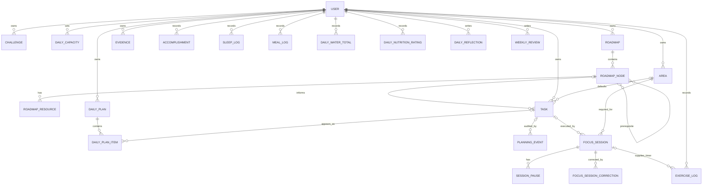

# Schema v1 domain model

**Status:** Phase 0 only; no migrations authorized.

## Conventions

- UUID primary keys; UTC `timestamptz` instants; IANA timezone snapshots for local-date attribution.
- Direct `user_id` ownership on user-owned aggregates.
- Mutable records have `created_at` and `updated_at`; audit/event rows are append-only.
- Active taxonomy/content is normally archived when history depends on it. Explicit deletion rules for health/reflections and full account erasure are exceptions.

## Relationships

## Identity, planning, and challenges

- **User:** email login, display name, timezone, `week_starts_on`, Django auth fields. Initial user is Monday-start.
- **Challenge:** name, inclusive dates, status, `is_primary`. Challenges may overlap; a partial unique constraint permits at most one primary challenge, and zero is valid.
- **Area:** user-defined name/slug/color/icon/order and archive timestamp.
- **DailyCapacity:** local date and timezone snapshot, available/deep-work minutes, free-text commitments. `LifeMode` is deferred.
- **DailyPlan:** local date, immutable timezone snapshot, optional challenge, notes; unique per user/date.
- **DailyPlanItem:** dated task appearance, primary/secondary kind, order, planning snapshots, state (`current`, `carried_forward`, `removed`). Historical rows are retained. At most one current appearance may exist for an unfinished task.
- **PlanningEvent:** append-only `planned`, `carried_over`, `removed`, `completed`, `skipped`, or `reopened` event with source/destination occurrence references and snapshots.

The service locks the plan while enforcing at most three current primary outcomes. No PostgreSQL count trigger is used in v0.1.

## Roadmaps

- **Roadmap:** title, description, optional area, status, ordering/completion/archive fields.
- **RoadmapNode:** adjacency-list node with optional parent; type `section`, `topic`, or `item`; arbitrary depth; ordered siblings; explicit completion/skip state. Only `item` nodes are eligible measurable leaves. A node cannot parent itself, cross roadmaps/users, or create a cycle.
- **RoadmapNodePrerequisite:** directed, unique same-roadmap edge. Unmet edges are displayed but do not gate transitions.
- **RoadmapResource:** multiple ordered labeled URLs per node.

`Task.roadmap_item_id` is nullable and must reference an `item`; many tasks may reference the same item. Task completion never silently completes an item.

## Work execution

- **Task:** title/description, optional area and roadmap item, priority, estimate, task type, deep-work default, status `planned|completed|skipped`, terminal timestamps, archive timestamp. Reopen clears terminal state and returns to `planned`.
- **FocusSession:** optional task/roadmap item, required area, state `active|paused|completed|cancelled`, server timestamps, frozen terminal duration, outcome/learning/difficulty/notes, explicit deep-work selection, timezone/title/area/task-type snapshots, and ordered original roadmap-ancestry snapshot.
- **SessionPause:** session interval; client-generated UUID supports retry; at most one open pause per session.
- **FocusSessionCorrection:** append-only actor, reason, corrected timestamp, and before/after JSON limited to correctable finished-session fields.
- **Evidence:** kind `url|github|note`, exactly one supported parent (task, focus session, roadmap node, or accomplishment), and kind-appropriate URL/text. There are no file fields.
- **Accomplishment:** occurrence date/timezone, title/description, optional area/task/session links.

Session UUIDs are client-generated for idempotent start retries. Row locks, expected versions, idempotent target-state responses, and the partial unique open-session index handle races without a command-receipt table.

## Health and reflection

- **SleepLog:** start/wake instants, creation-time timezone snapshot, immutable derived `wake_local_date`, quality, notes. Per-user intervals may not overlap.
- **ExerciseLog:** health metadata, start/end or duration, optional area and optional focus-session link. Timed exercise uses that focus session; the log is not a timer. Exercise intervals may not overlap other exercise intervals.
- **MealLog:** local date/timezone, type, description, rating; no photo.
- **DailyWaterTotal:** one row per user/local date with timezone snapshot and total millilitres.
- **DailyNutritionRating:** one row per user/local date with timezone snapshot, rating, and optional notes; separate from reflection.
- **DailyReflection:** one row per user/local date with timezone snapshot, prompts and subjective ratings; facts remain live-derived.
- **WeeklyReview:** Monday `week_start_date`, Sunday `week_end_date`, timezone snapshot, prompts and optional close timestamp; no frozen factual JSON.

## Key integrity rules

- Unique open focus session per user where status is active/paused; one open pause per session.
- Area is non-null when a session starts; historical label survives FK archival/deletion.
- Production URLs are HTTPS; only configured localhost development origins may use HTTP.
- End times do not precede starts; durations/minutes are non-negative; ratings are bounded.
- Sleep overlap and exercise overlap are rejected transactionally with PostgreSQL range/exclusion constraints where practical.
- Daily report values are derived, never persisted as report snapshots.
