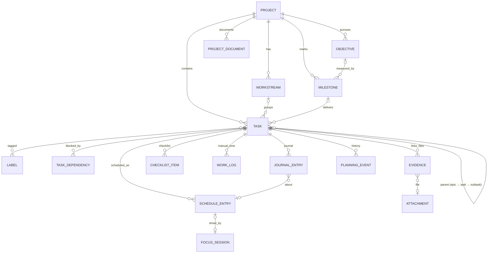

# Project workspaces: architecture proposal

**Status:** Approved 2026-11-24 with the recommendations in §10 and the clarifications in §11.
**Branch:** `feature/project-workspaces`, rebased onto `main` after the scheduler merge (`4ad209d`). Each phase is developed on its own branch off this one and merged back only with the owner's approval.

The goal is personal project management inside CharityOS (projects, epics, tasks, a journal, a board, weekly planning), joined to the scheduler that already exists. It is not an enterprise Jira clone: one user, no sprints, no workflow editor, no permissions matrix.

---

## 1. Audit

### 1.1 What CharityOS already has

| Model | Today | Verdict |
|---|---|---|
| `planning.Task` | Title, description, area, roadmap item, priority, estimate, deep-work flag, status `planned/completed/skipped`, archive. About a dozen code paths read its status. | **Extend it.** It becomes the single task system for personal tasks, project tasks, epics and subtasks. |
| `planning.PlanningEvent` | Append-only task events (planned, carried over, completed, skipped, reopened) with JSON snapshots. | **Reuse as task change history** with more event types. |
| `planning.DailyPlan/DailyPlanItem` | A task's appearance on a day; max three primaries. | Unchanged. Project tasks can still be put on a day. |
| `scheduling.ScheduleEntry` | Time block with optional `task`, `roadmap_node`, `focus_session`; full lifecycle. | **Unchanged lifecycle.** It gains project context and two integration actions. |
| `execution.FocusSession` | Server-authoritative focused time, already has `task`. | Unchanged. It remains the only source of focused time. |
| `records.Evidence` | Note/URL/GitHub, attached to exactly one of task, session, roadmap node, accomplishment. | **Extend** with files and milestone/objective parents; it becomes "links and files". |
| `roadmaps.Roadmap/RoadmapNode` | Learning curricula (section/topic/item). | **Kept separate.** Learning paths are not project plans. A project's "roadmap" view is built from its objectives, milestones and epics. |

There are no projects, epics, dependencies, journals, checklists, work logs, documents or file uploads today. File uploads were a deliberate v0.1 limit, so adding them needs the security work in §6.

### 1.2 FundBridge: verified repository state

Source: `/home/user/FundBridge/FundBridge` (Flask + PostgreSQL + React/Vite), audited read-only on 2026-11-24. Remote refs were last fetched on 2026-11-18. PR states come from `gh pr list`.

| Where the work is | Evidence |
|---|---|
| **On `origin/main` (6f3c335, 2026-11-11)** | PR #2 backend foundation; PRs #4/#6 AI services and the SMS/USSD feature-phone layer. |
| **Open PR, not merged** | PR #8 `feat/backend-core → main` (21 commits: AUD-1 payout race fix and AUD-2 login fix in `941766c`, frontend rebuild via PR #10); PR #7 `feat/ai-integration-qa → feat/backend-core`; PR #11 payout-review 404 fix. |
| **Pushed branch, no PR** | `fix/fin-1-refund-reversals` (FIN-1 refund/reversal ledger debits, 2026-11-18); `ci/backend-postgres`, `ci/frontend-checks`. |
| **Documented open findings** | `docs/RELEASE_AUDIT.md` §8 (2026-11-17): FIN-2, PAY-1, AUD-7, OPS-1 (P0); AUD-3/4/5/8/11/12, PRIV-1 (P1); AUTH-3, AUD-6/9/10, OPS-2 (P2); T-1. |
| **Blocked on the owner or external parties** | PayPal Sandbox credentials, a licensed payout provider, an Africa's Talking account and USSD code, production hosting decisions. |
| **No evidence found** | Business validation (customer interviews, partners, licensing progress). That workstream stays empty rather than guessed. |

Note: the local `main` branch in that checkout is stale (it shows only the initial commit). `origin/main` is the truth used above.

### 1.3 QUAHAXTON: verified material

Only one artifact exists on this machine: `~/Downloads/Neon QUAHAXTON Sci-Fi Emblem.png` (1536×1024, 2026-11-23). It shows an uppercase QUAHAXTON wordmark in a neon cyan and blue concentric sci-fi emblem on a dark background. There are no product, requirements or formation documents, so QUAHAXTON starts with structure and no recorded progress.

---

## 2. Domain design



### 2.1 New app `projects`

| Model | Fields | Rules |
|---|---|---|
| **Project** | user, name, `key` (2–6 capitals: `FB`, `QX`), slug, summary, description, status (`active/on_hold/completed/archived`), stage (free text, user-owned), colour, logo (attachment), area (category for scheduler colour and time-by-category), start/target dates, `next_number` | Key unique per user. No parent project: FundBridge and QUAHAXTON stay independent until a relationship is configured explicitly. |
| **Workstream** | project, name, description, position, archived_at | Name unique per project. |
| **Objective** | project, title, description, status (`active/achieved/dropped`), target date, achieved_at | Marking achieved **requires evidence** (§2.4). |
| **Milestone** | project, objective?, title, description, due date, status (`planned/reached/cancelled`), reached_at | Marking reached **requires evidence**. There is no "missed" state; a past due date is shown as such without a penalty status. |
| **ProjectDocument** (+ revisions) | project, title, kind (`note/prd/decision/research/meeting/other`), body (Markdown), status (`draft/active/superseded`), version | Every save keeps the previous body as a revision. PRDs live here. |

### 2.2 `planning.Task` extended (one task system)

| Field | Purpose |
|---|---|
| `project` (nullable) | Personal tasks keep `null`, so existing data is unchanged. |
| `kind`: `task` / `epic` | An epic is a task with children. Same journal, links and history, so nothing is duplicated. |
| `parent` (self, nullable) | Epic → task → subtask. Cycle-checked in the service; epics cannot have a parent. |
| `number` | Per-project sequence, giving keys like `FB-12`, allocated under a project row lock. |
| `status` | `backlog`, `todo`, `in_progress`, `in_review`, `blocked`, `done`, `cancelled` (migration in §5). |
| `workstream`, `milestone`, `labels` (M2M `Label`) | Grouping. All must belong to the same project (service-validated, tested). |
| `start_date`, `due_date`, `planned_week` | Deadlines and lightweight weekly planning. `planned_week` is the Monday of the week the task is committed to. |
| `priority` | Choices 0–4 (none/low/medium/high/urgent) over the existing column. |
| `rank` | Board/backlog order within a column. |
| `notes` (+ `TaskNoteRevision`) | Personal working notes: freely editable, every save keeps the old text. |
| `blocked_reason` | Short reason when status is `blocked`. Detail goes in a journal entry. |
| `external_ref` | Stable import key (for example `fundbridge:pr:8`) so seeding is idempotent and traceable. |
| `version` | Optimistic concurrency, like schedule entries. |

New `planning` models:

| Model | Fields | Rules |
|---|---|---|
| **Label** | user, project?, name, colour | Unique name per user and project. |
| **TaskDependency** | task, depends_on, created_at | No self-links; unique pair; cycle check; both tasks owned by the same user. Starting a task with unfinished dependencies warns but does not block. |
| **TaskJournalEntry** (+ revisions) | task, kind (`progress/research/decision/challenge/lesson/next_step/note`), body, optional `schedule_entry`, optional `focus_session`, created_at, edited_at, version | **Append-only history:** entries can be edited (each edit stores a revision) but never deleted. A wrong entry is *retracted*: hidden by default, kept for audit. |
| **ChecklistItem** | task, group (`acceptance/checklist`), text, done, done_at, position | Acceptance criteria are checkable items. |
| **WorkLog** | task, local date, minutes, note | **Manual time only**: work that was neither a focus session nor a timed schedule entry. It cannot reference either. |

### 2.3 Time ledger (no double counting)

A task's actual time is derived, never copied:

1. Completed `FocusSession` rows with `task = T` (this includes focus-tracked schedule entries, whose session already carries the task).
2. Plus completed **manual** `ScheduleEntry` rows with `task = T` and no focus session, using their recorded actual time.
3. Plus `WorkLog` rows for `T`.

Epic and project totals sum their descendants. Each minute has exactly one source by construction, and a test asserts it. One tightening keeps this true: an entry's `task` can no longer change once a focus session is linked to it.

### 2.4 Evidence, links and files

`records.Evidence` gains `kind=file` (pointing to an `Attachment`), a `role` (`reference` for useful links, `evidence` for proof) and `milestone`/`objective` parents. Its "exactly one parent" constraint is rebuilt. Milestones and objectives can only be marked reached or achieved when at least one `evidence` item is attached. This is how "do not mark the company registered or a product launched without evidence" is enforced in the database layer, not just the UI.

### 2.5 History and activity

`PlanningEvent` gains event types: `created`, `updated` (field diffs in the snapshot), `status_changed`, `moved`, `scheduled`, `work_logged`, `dependency_added/removed`, `journal_added`. The task's change history is this event list.

The personal activity feed is **derived**, not stored: status changes to done, journal entries (lessons, research, decisions, progress), milestones reached, and completed focus sessions and schedule entries on project tasks. It is cursor-paginated and can be filtered by project.

---

## 3. Scheduler integration

| Capability | How |
|---|---|
| Schedule an existing task | "Schedule" in the task workspace opens quick add prefilled (title, project category, task link, focus on for engineering work). It uses the existing `POST /schedule-entries`. |
| Create a task from an activity | `POST /schedule-entries/{id}/create-task {project, parent?}` creates the task and links the entry in one transaction. |
| Record actual time | Unchanged: focus timer or manual actuals, feeding the ledger in §2.3. |
| Partial completion | The finish sheet for a project-task entry asks for an outcome. "Partly done" leaves the task `in_progress` and offers "Schedule the rest", which creates a follow-up entry for the same task. |
| Reschedule unfinished work | Existing reschedule (history kept). Task notes, journal, links and history are untouched because they belong to the task, not the entry. |
| Progress updates linked to sessions | The finish sheet's "Progress update" field creates a `progress` journal entry linked to the schedule entry and its focus session. |
| Status from scheduling | Starting an entry for a `todo`/`backlog` task moves it to `in_progress` (logged). "Also mark the task done" moves it to `done`. Nothing else changes task status implicitly. |
| Today | "Unscheduled tasks" shows today's plan, this week's planned tasks and tasks due within 7 days, not the entire backlog. Entries show `FB-12 · FundBridge`. |
| Project calendar | `/schedule-entries?project=` plus milestone and due-date markers. |

Ownership and lifecycle rules for schedule entries do not change.

---

## 4. API (all `/api/v1`, session auth + CSRF, owner-scoped)

```text
GET/POST   /projects                     GET/PATCH /projects/{id}     POST /projects/{id}/archive
GET        /projects/{id}/overview       progress by status/epic/workstream/milestone, time ledger, throughput
GET        /projects/{id}/roadmap        objectives → milestones → epics with dates and progress
GET        /projects/{id}/board          tasks grouped by status (rank order)
GET        /projects/{id}/calendar       ?start&end: entries + milestones + due dates
GET/POST   /workstreams /objectives /milestones /labels     PATCH each
POST       /milestones/{id}/reach        requires evidence ids     (same for /objectives/{id}/achieve)
GET/POST   /tasks?project&status&kind&parent&workstream&milestone&label&planned_week&q
GET        /tasks/{id}/workspace         task, children, checklist, journal, links, ledger, entries, dependencies, history
POST       /tasks/{id}/transition        {status, expected_version, reason?}
POST       /tasks/{id}/move              {status, before?, after?}   board/backlog ordering
POST       /tasks/{id}/complete|skip|reopen      kept as compatibility aliases (done/cancelled/todo)
GET/POST   /tasks/{id}/journal           PATCH /journal-entries/{id} (stores revision)  POST …/retract
GET/POST   /tasks/{id}/checklist         PATCH/DELETE /checklist-items/{id}
GET/POST   /tasks/{id}/work-logs         /task-dependencies (POST/DELETE)
GET/PATCH  /tasks/{id}/notes             GET …/notes/revisions
POST       /schedule-entries/{id}/create-task
GET/POST   /projects/{id}/documents      PATCH /documents/{id}  GET …/revisions
GET        /activity?project&cursor
POST       /attachments (multipart)      GET /attachments/{id}/download
GET        /weekly-plan?week=            POST /weekly-plan/carry-over
```

Errors follow the scheduler's format: 400 validation, 404 for missing or other users' records, 409 version conflicts.

---

## 5. Migration plan and backwards compatibility

| Change | Migration | Compatibility |
|---|---|---|
| Task status workflow | Data migration `planned→todo`, `completed→done`, `skipped→cancelled`; `skipped_at` renamed `cancelled_at`; terminal-field constraint rebuilt. Fully reversible. | `complete/skip/reopen` endpoints keep working. Every server path that checked `planned` now checks "open" (backlog/todo/in progress/in review/blocked). Frontend strings updated in the same commit. Old analytics read `done`. |
| Task project fields | Nullable columns, so existing personal tasks are unaffected. | Personal tasks stay in Today and the daily plan exactly as now. |
| Evidence parents and files | Constraint dropped and recreated with new parents. | Existing evidence rows are all valid under the new constraint (tested). |
| PlanningEvent types | Choices only, so no schema change. | Old events read the same. |
| Entry task immutability with focus | Service rule only. | Tightening: an entry with a linked focus session cannot switch task. |

Each schema change ships with a **migration test** (roll back, seed old-shape rows, migrate forward, assert), like `test_category_migration.py`. Recommended deployment step: `pg_dump` before `migrate`.

---

## 6. Security and privacy

- Every new model has a direct `user` FK. Querysets are owner-scoped, and related IDs are validated as owned *and* belonging to the same project. Each endpoint gets cross-user tests (404, no leakage through counts or activity).
- **Attachments**
  - Allowlist: PDF, PNG, JPEG, WebP, plain text, Markdown, CSV, and Office documents.
  - Type checking: extension and magic-byte sniffing must agree. SVG, HTML and scripts are always refused.
  - Limits: 10 MB per file, 500 MB per user.
  - Filenames are sanitised; files are stored under random IDs.
  - Downloads are owner-checked and sent as `Content-Disposition: attachment`, with `X-Content-Type-Options: nosniff`, `Cache-Control: private, no-store` and a restrictive CSP. Only raster images are shown inline, for logos.
  - The service worker already never caches `/api/`.
- Notes, journals and documents are private like everything else. No sharing, no public URLs.
- No paid services and no new backend dependencies. File-type sniffing uses the standard library.

---

## 7. Interface (mobile first)

- **Navigation:** the bottom tab "Roadmaps" becomes **"Projects"**, which holds the project list and, as a second section, the existing learning roadmaps. The bar stays at five tabs.
- **Project workspace:** a horizontally scrollable sub-tab bar with Overview · Board · Backlog · Roadmap · Calendar · Docs · Activity.
- **Board:** on phones, swipeable columns (scroll-snap) with a "Move to…" sheet instead of fragile touch dragging. Desktop adds native drag and drop with no library.
- **Task workspace (full screen):**
  - Header: key, status, priority, dates.
  - Body: description and acceptance criteria, then checklist and subtasks.
  - Journal: a timeline with a composer and kind chips.
  - Notes: with revision history.
  - Also: links and files, time (estimate vs ledger, log time), schedule entries with a **Schedule** button, dependencies, and change history.
- **Weekly plan:** this week's committed tasks by project, estimate vs available capacity, "schedule onto a day", "carry unfinished to next week".
- **Activity feed:** under Insights (personal) and in each project.

---

## 8. Seeding without fabrication

The management command `seed_project_workspaces --email … --dry-run` prints exactly what it would create. Nothing is written until the plan is approved. Every seeded item stores its `external_ref` and an evidence link (PR, commit or document path).

- **FundBridge (FB):**
  - Workstreams: Product development, Payment integrations, Beneficiary experience, Security, Testing, Deployment & operations, Business validation.
  - Items carry the status of verified evidence only (proposed rule, see decision 4):
    - **Done:** merged to `origin/main`.
    - **In Review:** open PR.
    - **In Progress:** pushed branch with no PR.
    - **To Do / Blocked:** documented open audit findings. Blocked items get the external reason.
  - Business validation gets no tasks.
- **QUAHAXTON (QX):**
  - Stage "Concept & discovery". Not registered, so no registration or IP milestone is marked.
  - The eight workstreams: Vision and strategy; Problem discovery and validation; Product research and prioritisation; Requirements and PRDs; Technical architecture; Prototypes and MVP; Brand and IP; Business formation and growth.
  - A "Brand direction" document describing the existing emblem, with the emblem imported as the project logo if approved.
  - No epics, product modules or progress are invented. Future product ideas are added as `backlog` epics labelled **concept**.

---

## 9. Implementation plan

Each phase is its own set of atomic commits with tests. All phases stay on this branch, which is not pushed or merged.

| Phase | Scope | Tests |
|---|---|---|
| P1 | Task status workflow, compatibility aliases, history event types, Today filter | Migration test (both directions), API compatibility, existing suites |
| P2 | Projects, workstreams, objectives, milestones, labels, task hierarchy, numbering, dependencies, constraints | Ownership, cross-project validation, cycles, numbering races, evidence-gated milestones |
| P3 | Task workspace: journal and revisions, notes and revisions, checklist, work logs, time ledger, history | Append-only guarantees, ledger no-double-count, reschedule/reopen/complete keep history |
| P4 | Attachments and extended evidence | Type spoofing, size/quota, cross-user download, response headers |
| P5 | Scheduler integration | Schedule from task, create task from entry, partial and remainder, progress updates linked to sessions, focus immutability |
| P6 | Frontend: Projects tab, workspace views, board, task workspace, weekly plan, activity, Today integration | Component tests for each view, board moves, journal editing, offline states |
| P7 | Project analytics and activity feed | Accuracy against seeded fixtures, timezone grouping |
| P8 | `seed_project_workspaces` dry-run, then apply after approval | Idempotency; never overwrites user edits |
| P9 | Mobile acceptance (360–430 px + desktop), migration-steps doc | Scripted browser scenario like `docs/acceptance/` |

## 10. Decision log (approved 2026-11-24)

| ID | Decision | Outcome |
|---|---|---|
| D1 | One task system | Extend `planning.Task`. No second task system. |
| D2 | Navigation | The Roadmaps tab becomes **Projects**; learning roadmaps stay reachable inside it. |
| D3 | File storage | PostgreSQL, 10 MB per file, 500 MB per user, content validation, authenticated download only. |
| D4 | FundBridge status rule | Accepted, based on verified GitHub state. Every seeded item keeps links to its PR, commits and audit finding. |
| D5 | QUAHAXTON seed | Only the eight workstreams, the brand-direction note and the existing emblem. No milestones, epics, completed work or progress. |
| D6 | Formatting | Markdown via `react-markdown` for notes, journals and PRDs. |

Commits reference these IDs (for example `Refs: D1, §5`) so the history maps back to this document.

## 11. Owner clarifications (binding)

- FundBridge and QUAHAXTON are completely independent projects. There is no parent/child or shared data between them.
- Do not search Google Drive for QUAHAXTON documents (not yet authorised).
- Migrations preserve task history (`PlanningEvent`), journal revisions, evidence and all existing records.
- Status migrations are tested in both directions.
- Existing task endpoints and the scheduler stay compatible.
- Objectives and milestones are never completed automatically, and never without evidence.
- Nothing is merged or pushed without the owner's approval.

## 12. Verification against `main` (4ad209d)

Re-checked after the scheduler merge and rebase:

- **Confirmed:** the models and relationships in §1.1; `FocusSession.task` is set from the entry's task when a focus entry starts (ledger rule 1 in §2.3 holds); the bottom tab is still named "Roadmaps"; the next planning migration is `0007`.
- **Missed in §1.1, now in scope for P1:** `roadmaps/services.py` (`next_actions`) filters linked tasks by `status=planned`. It must use the open statuses.
- **Pre-existing defect, fixed in P1:** `TaskSerializer` lets `PATCH /tasks/{id}` write `status` directly, bypassing the completion/skip timestamps. A PATCH to `completed` violates the terminal-field constraint and returns HTTP 500. P1 routes every status write through the transition service.
- **Confirmed need for the P5 tightening:** `update_entry` still allows changing an in-progress entry's task, including focus-tracked ones.
- **Status dependencies (complete inventory):**
  - Backend: `planning/services.py` (`add_plan_item`, `carry_over`, `transition_task`); `planning/models.py` (choices, `skipped_at`, constraint); `api/serializers.py` (`TaskSerializer`); `api/views.py` (complete/skip/reopen and the legacy metrics `task__status`); `api/schedule_views.py` (unscheduled tasks); `roadmaps/services.py`; `scheduling/services.py` (`complete_task`).
  - Frontend: `ProfileScreen` history filter; `EntrySheet` task-status checks; `RoadmapsScreen` creates tasks with `status: "planned"`.
  - Tests: two assertions in `test_schedule_entries.py`. Every other status reference in the tests is for sessions or roadmap nodes.

## 13. P1 specification: task status workflow

**Branch:** `feature/task-status-workflow` off `feature/project-workspaces`.

| Old | New | Timestamp |
|---|---|---|
| `planned` | `todo` | none |
| `completed` | `done` | `completed_at` (kept) |
| `skipped` | `cancelled` | `skipped_at` renamed to `cancelled_at` (value kept) |
| — | `backlog`, `in_progress`, `in_review`, `blocked` | none |

- **Migration `planning.0007_task_status_workflow`** (depends on `planning.0006` only; a `scheduling` dependency was considered and dropped because it would couple rollbacks for no benefit):
  1. Drop the two task status constraints.
  2. Rename `skipped_at` to `cancelled_at`.
  3. Widen `status` choices.
  4. Remap the data.
  5. Recreate the constraints for the new states.
- **Reverse migration:** `todo`, `done` and `cancelled` map back exactly. `backlog`, `in_progress`, `in_review` and `blocked` cannot exist in the old schema and map to `planned` with both timestamps cleared. Old data round-trips byte-for-byte (tested). Data created after the migration loses only the distinction between open states.
- **Untouched by the migration:** `PlanningEvent` rows (history keeps saying "skipped" or "completed", as it happened), `DailyPlanItem`, `Evidence`, focus sessions and schedule entries.
- **Services:** `OPEN_STATUSES` replaces the `planned` checks. `transition_task` accepts every new status plus the legacy names (`planned`, `completed`, `skipped`), sets the matching timestamps, is idempotent, and records a `status_changed` event with `{from, to}`. The existing `completed`, `skipped` and `reopened` event types are still written for those transitions.
- **API compatibility:**
  - `POST /tasks/{id}/complete`, `skip` and `reopen` keep working.
  - `POST /tasks` accepts legacy `status` values.
  - `PATCH` status changes go through the service.
  - New `POST /tasks/{id}/transition {status}`.
  - Responses add a read-only, deprecated `legacy_status` for one release.
- **Rollback:** take a `pg_dump`, then `migrate planning 0006`.
- **As built:** `planning.0008` adds the `status_changed` history event choice (no SQL). Repeated transitions are no-ops that keep the original timestamp. Status writes through `POST`/`PATCH /tasks` also go through the service; this fixed the HTTP 500 recorded in §12. Full migration notes: [migrations.md](migrations.md).
- **Tests:**
  - A migration test in both directions with history, plan items, evidence, sessions and schedule entries attached.
  - Constraint tests.
  - Transition and compatibility API tests.
  - Next-actions ranking.
  - The scheduler's `complete_task`.
  - Updated frontend checks.

## 14. Commit conventions for this work

- One coherent, independently green change per commit: migrations, models, services, API, frontend and docs are separate when they are separate concerns. Tests ship with what they verify.
- Conventional Commit subjects; bodies state purpose, design references (`Refs: D1, §13`), migration dependencies and rollback notes.
- No squashing, no force-pushing, no rewriting published history.
- Each phase ends with a commit-by-commit summary (SHA, message, files, purpose, verification) and checks for a clean tree, everything committed, green tests, readable history, and no unrelated files or secrets.
